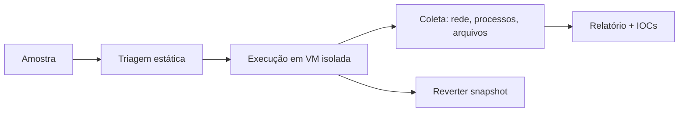

---
tags:
  - malware
  - defensivo
aliases:
  - "Lab de malware"
  - "Malware lab"
tipo: conceito
nivel: intermediario
criado: 2026-10-24
relacionados:
  - "[[Criar Laboratório de Malware Seguro]]"
  - "[[Sandbox de Rede]]"
  - "[[Sandbox por Virtualização Completa]]"
---
# Laboratório de Análise de Malware

> [!warning] Conteúdo estritamente defensivo e educacional
> Não há aqui código malicioso nem instruções para criar, aperfeiçoar ou distribuir malware. Trabalhe só com amostras obtidas legalmente e dentro de um laboratório isolado.

Um laboratório permite estudar o comportamento de amostras suspeitas sem risco para redes reais.

## Componentes

| Componente | Função |
|---|---|
| Host de laboratório | Executa o hipervisor; sem dados pessoais; disco criptografado |
| VM de análise (Windows/Linux) | Onde a amostra é observada; snapshot limpo |
| VM de apoio (REMnux) | Serviços simulados (DNS/HTTP) e ferramentas Linux |
| Rede isolada | Sem rota para internet/LAN — ver [[Sandbox de Rede]] |
| Coleta de telemetria | Captura de tráfego, logs de processos e arquivos |
| Área de transferência de amostras | Canal unidirecional e verificado por hash |

## Princípios

1. **Contenção primeiro:** valide o isolamento antes de qualquer análise.
2. **Estado limpo** a cada amostra (snapshot).
3. **Registro completo** do que foi feito.
4. **Nada de credenciais reais** nas VMs.
5. Considere [[Evasão de Sandbox por Malware]] ao interpretar resultados.

## Exercício

Desenhe o diagrama de rede do seu laboratório e marque onde o isolamento é garantido.

## Veja também

- [[Criar Laboratório de Malware Seguro]]
- [[Análise Estática e Dinâmica]]
- [[Fluxo de Triagem de Amostras]]
- [[MOC - Análise de Malware]]
