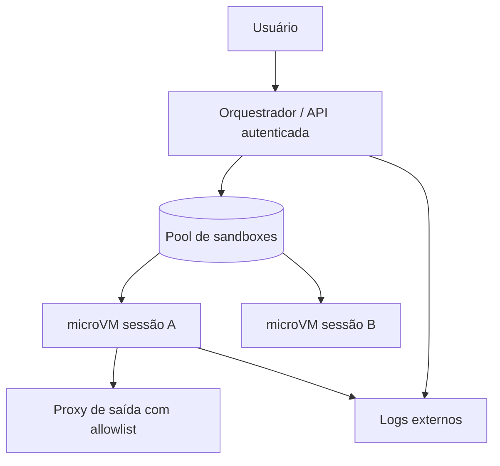

---
tags:
  - ia
  - agentes
aliases:
  - "Arquitetura de agentes"
  - "Sandbox por sessão"
tipo: arquitetura
nivel: avancado
criado: 2026-10-24
relacionados:
  - "[[Sandbox para Código Gerado por IA]]"
  - "[[Sandbox por MicroVMs]]"
  - "[[Sandbox em Nuvem]]"
---
# Arquiteturas de Sandbox para Agentes

## Padrão 1 — Sandbox por execução (sem estado)

Cada chamada cria um container/microVM, executa e destrói. Simples e seguro; sem memória entre chamadas.

## Padrão 2 — Sandbox por sessão (com estado)

Uma microVM por conversa/tarefa, mantida por um tempo (TTL), com snapshot/restauração. Permite instalar pacotes e continuar o trabalho.

## Padrão 3 — Pool aquecido

Mantém sandboxes pré-criadas para reduzir latência; entrega uma limpa a cada requisição e descarta após o uso.

| Decisão | Recomendação |
|---|---|
| Fronteira | microVM/gVisor para multi-inquilino |
| Credenciais | Nunca dentro da sandbox |
| Comunicação | API estreita orquestrador↔sandbox (executar, ler/escrever arquivo) |
| Estado | Volume por sessão, apagado no fim |
| Isolamento entre usuários | Sandbox **nunca** compartilhada entre usuários |

> [!info] Serviços gerenciados
> Há serviços de sandbox para agentes ([[Sandbox em Nuvem]]) que implementam esses padrões; avalie localização de dados e termos.

## Exercício

Escolha o padrão (1, 2 ou 3) para um assistente de análise de dados e justifique.

## Veja também

- [[Sandbox para Código Gerado por IA]]
- [[Sandbox por MicroVMs]]
- [[Sandbox em Nuvem]]
- [[MOC - IA e Agentes]]
