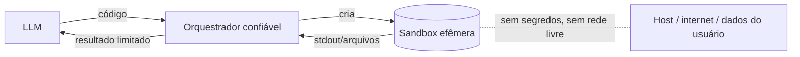

---
tags:
  - ia
  - agentes
aliases:
  - "Code interpreter"
  - "Execução segura de código de LLM"
  - "Sandbox para LLM"
tipo: ia
nivel: intermediario
criado: 2026-10-24
relacionados:
  - "[[Caso - Agentes de IA e Código de LLM]]"
  - "[[Criar Sandbox para Código de IA]]"
  - "[[Prompt Injection e seus Riscos]]"
---
# Sandbox para Código Gerado por IA

Modelos de linguagem escrevem código que pode ser executado automaticamente (interpretadores de código, agentes de programação). O código gerado deve ser tratado como **não confiável**: pode conter erros destrutivos ou ter sido induzido por conteúdo malicioso (ver [[Prompt Injection e seus Riscos]]).

## Requisitos mínimos

| Requisito | Como |
|---|---|
| Isolamento forte | microVM ([[Sandbox por MicroVMs]]), gVisor ou, no mínimo, container endurecido |
| Efêmero | Uma sandbox por sessão/execução; destruída ao final |
| Sem segredos | Nenhuma chave de API ou token do usuário no ambiente |
| Rede restrita | Sem rede ou saída por lista de permissão — [[Limites de Rede e Sistema de Arquivos para Agentes]] |
| Sistema de arquivos | Somente o diretório de trabalho; raiz somente leitura |
| Recursos | CPU, memória, processos, disco e **tempo** limitados |
| Observável | Logs de comandos e saída — [[Logs e Monitoramento]] |
| Saída tratada | Limitar tamanho; não interpretar a saída como instrução confiável |

> [!danger] Nunca execute código de LLM direto no host
> Nem "só para testar". Um único comando destrutivo ou exfiltração bastam.

Implementação de exemplo: [[Criar Sandbox para Código de IA]].

## Exercício

Liste 5 coisas ruins que um código gerado por LLM poderia fazer no seu computador e qual controle da tabela impediria cada uma.

## Veja também

- [[Criar Sandbox para Código de IA]]
- [[Arquiteturas de Sandbox para Agentes]]
- [[Permissões de Agentes de IA]]
- [[Checklist de Segurança para Agentes]]
- [[MOC - IA e Agentes]]
