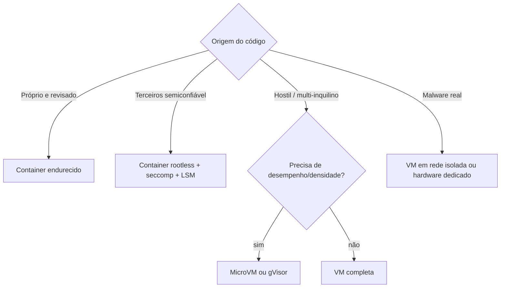

---
tags:
  - boas-praticas
  - arquitetura
aliases:
  - "Decisão de isolamento"
tipo: fluxo
nivel: intermediario
criado: 2026-10-24
relacionados:
  - "[[Comparativo por Nível de Isolamento]]"
  - "[[Modelo de Ameaças]]"
---
# Como Escolher o Nível de Isolamento

| Pergunta | Se "sim"... |
|---|---|
| O código pode ser deliberadamente malicioso? | Evite kernel compartilhado puro |
| Há dados de outros usuários no mesmo host? | microVM/VM por inquilino |
| Preciso de SO diferente do host? | VM |
| Latência de inicialização é crítica? | microVM, Wasm ou pool aquecido |

## Veja também

- [[Comparativo por Nível de Isolamento]]
- [[Modelo de Ameaças]]
- [[Padrões de Projeto para Sandboxes]]
- [[MOC - Boas Práticas]]
