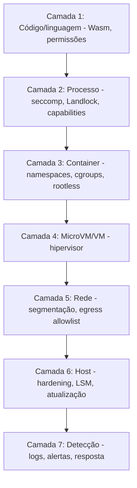

---
tags:
  - boas-praticas
  - arquitetura
aliases:
  - "Defense in depth"
  - "Camadas de segurança"
tipo: conceito
nivel: intermediario
criado: 2026-10-24
relacionados:
  - "[[Fuga de Sandbox]]"
  - "[[Princípio do Menor Privilégio]]"
  - "[[Sandbox de Processo]]"
---
# Defesa em Profundidade

Nenhuma barreira é perfeita; por isso empilhamos **camadas independentes**, de modo que a falha de uma não comprometa tudo.

| Camada | Exemplo de controle |
|---|---|
| Identidade/segredos | Tokens curtos, escopo mínimo |
| Execução | Usuário não-root, `--cap-drop=ALL`, seccomp |
| Isolamento | gVisor/microVM |
| Rede | `--network none`, proxy com allowlist |
| Dados | Sintéticos; criptografia |
| Operação | Patching, logs externos, descarte |

> [!tip] Camadas devem falhar de forma independente
> Duas camadas que dependem do mesmo componente (ex.: o mesmo kernel) contam como uma só.

## Exercício

Para um container que roda código de terceiros, liste uma camada de cada nível do diagrama.

## Veja também

- [[Fuga de Sandbox]]
- [[Modelo de Ameaças]]
- [[Endurecimento (Hardening)]]
- [[Checklist de Criação de Sandbox]]
- [[MOC - Boas Práticas]]
