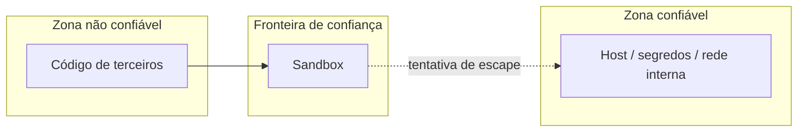

---
tags:
  - boas-praticas
  - arquitetura
aliases: []
tipo: conceito
nivel: avancado
criado: 2026-10-24
relacionados:
  - "[[Superfície de Ataque]]"
  - "[[Defesa em Profundidade]]"
  - "[[Fuga de Sandbox]]"
---
# Modelo de Ameaças

Modelar ameaças é responder: **o que estamos protegendo, de quem, por onde e como reduzimos o risco?**

## Passos

1. **Ativos:** dados, credenciais, host, rede, reputação.
2. **Atores:** usuário malicioso, código de terceiros, conteúdo injetado, insider.
3. **Fronteiras de confiança:** onde o nível de confiança muda (sandbox ↔ host).
4. **Pontos de entrada:** upload, API, rede, pastas compartilhadas.
5. **Ameaças** (por exemplo, com STRIDE).
6. **Mitigações** e **risco residual**.

## STRIDE aplicado a uma sandbox

| Ameaça | Exemplo | Mitigação |
|---|---|---|
| **S**poofing | Código se passa por outro usuário/serviço | Autenticação, identidades por sandbox |
| **T**ampering | Alterar arquivos do host ou imagens | Raiz somente leitura, assinatura de imagens |
| **R**epudiation | Ação sem rastro | Logs externos |
| **I**nformation disclosure | Ler segredos, exfiltrar dados | Sem segredos, sem rede livre |
| **D**enial of service | Consumir CPU/memória | Limites, timeout |
| **E**levation of privilege | Fuga de sandbox | Camadas, microVM, patching |

Veja o Canvas **Modelo de ameaças** (pasta Anexos).

## Exercício

Faça o modelo de ameaças de uma plataforma que executa código enviado por alunos, preenchendo a tabela STRIDE.

## Veja também

- [[Superfície de Ataque]]
- [[Defesa em Profundidade]]
- [[Fuga de Sandbox]]
- [[Checklist de Auditoria de Sandbox]]
- [[MOC - Boas Práticas]]
