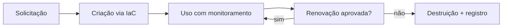

---
tags:
  - boas-praticas
  - arquitetura
aliases:
  - "Lifecycle"
  - "TTL"
tipo: pratica
nivel: intermediario
criado: 2026-10-24
relacionados:
  - "[[Descarte Seguro]]"
  - "[[Ambientes Efêmeros]]"
---
# Políticas de Ciclo de Vida

| Fase | Política |
|---|---|
| Criação | Somente por IaC/templates aprovados |
| Uso | TTL máximo; logs; limites |
| Atualização | Reconstruir a partir de imagem atualizada, não "remendar" |
| Descarte | Automático ao expirar; comprovação quando exigida |
| Exceções | Justificadas, com dono e prazo |

## Veja também

- [[Descarte Seguro]]
- [[Ambientes Efêmeros]]
- [[Checklist de Criação de Sandbox]]
- [[MOC - Boas Práticas]]
