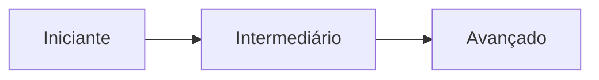

---
tags:
  - referencia
aliases: []
tipo: trilha
nivel: iniciante
criado: 2026-10-24
relacionados:
  - "[[MOC - Referência - Sandbox]]"
  - "[[MOC - Fundamentos - Sandbox]]"
---
# Trilha de Aprendizado

## Nível 1 — Iniciante
1. [[O que é um Ambiente Sandbox]]
2. [[Princípio do Menor Privilégio]] e [[Isolamento e Contenção]]
3. [[Sandbox vs VM vs Container vs Jail vs chroot]]
4. [[Criar Sandbox com Windows Sandbox]] ou [[Criar Sandbox com Docker]]
5. [[Exercícios - Iniciante]] e [[Flashcards - Fundamentos]]

## Nível 2 — Intermediário
1. [[Namespaces do Linux]], [[Cgroups]], [[Capabilities do Linux]], [[Seccomp]]
2. [[Sandbox por Containers]] e [[Criar Sandbox com Podman Rootless]]
3. [[Criar Sandbox com VMs]] e [[Snapshots e Reversão]]
4. [[Endurecimento (Hardening)]], [[Limites de Recursos]], [[Logs e Monitoramento]]
5. [[Caso - CI e CD]], [[Ambientes Efêmeros]]
6. [[Exercícios - Intermediário]]

## Nível 3 — Avançado
1. [[Sandbox por MicroVMs]], [[Sandbox por Kernel em Espaço de Usuário]], [[Sandbox por WebAssembly]]
2. [[Fuga de Sandbox]] e os [[MOC - Exercícios e Casos|estudos de caso]]
3. [[Modelo de Ameaças]] e [[Defesa em Profundidade]]
4. [[Laboratório de Análise de Malware]] e [[Evasão de Sandbox por Malware]]
5. [[Sandbox para Código Gerado por IA]] e [[Prompt Injection e seus Riscos]]
6. [[Exercícios - Avançado]]

## Veja também

- [[MOC - Referência - Sandbox]]
- [[Referências]]
- [[Glossário#Sandboxes e isolamento]]
