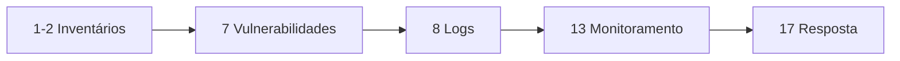

# CIS Controls

## Resumo

Os **CIS Controls** são um conjunto priorizado de ações defensivas, mantido pelo Center for Internet Security, derivado de ataques observados. A versão 8 reúne 18 controles e define **Grupos de Implementação** (IG1, IG2, IG3) conforme o tamanho e a maturidade da organização. Diferente do [[NIST CSF]], que descreve resultados, os CIS Controls focam em *salvaguardas* concretas, o que os torna práticos para decidir quais ferramentas adquirir ou desenvolver primeiro.

## Conceitos-chave

Controles da v8 (resumo):

1. Inventário de ativos corporativos
2. Inventário de software
3. Proteção de dados
4. Configuração segura
5. Gestão de contas
6. Gestão de controle de acesso
7. Gestão contínua de vulnerabilidades
8. Gestão de logs de auditoria
9. Proteção de e-mail e navegador
10. Defesa contra malware
11. Recuperação de dados
12. Gestão da infraestrutura de rede
13. Monitoramento e defesa de rede
14. Conscientização e treinamento
15. Gestão de provedores de serviço
16. Segurança de aplicações
17. Gestão de resposta a incidentes
18. Testes de intrusão

**IG1** = higiene básica; **IG2** = organizações com mais ativos e equipes; **IG3** = ambientes de alto risco.

## Como funciona

Cada controle contém salvaguardas numeradas (ex.: 7.1 estabelecer processo de gestão de vulnerabilidades). A adoção segue a ordem dos grupos: complete o IG1 antes de avançar. Muitas salvaguardas podem ser **automatizadas por integração**: inventário alimentando o scanner, scanner alimentando o ticketing, logs alimentando o SIEM.



## Exemplo prático

Verificação automatizada de uma salvaguarda (inventário atualizado) em Python:

```python
from datetime import datetime, timedelta

def ativo_desatualizado(ativo: dict, dias: int = 30) -> bool:
    ultimo = datetime.fromisoformat(ativo["ultimo_scan"])
    return datetime.now() - ultimo > timedelta(days=dias)

ativos = [{"host": "srv-01", "ultimo_scan": "2026-08-01T10:00:00"}]
print([a["host"] for a in ativos if ativo_desatualizado(a)])
```

> [!example] Integração
> Esse tipo de verificação roda agendada e abre ticket para ativos sem scan recente.

## Boas práticas

- Comece pelo IG1 e meça progresso por salvaguarda.
- Automatize coleta de evidências.
- Revise a lista de ativos continuamente; sem inventário, nada mais é confiável.

## Erros comuns

- Implementar controles avançados sem inventário.
- Contar controles como "feitos" sem evidência.
- Ignorar o controle 16 ao desenvolver ferramentas internas.

## Referências para aprofundar

- cisecurity.org/controls e mapeamentos CIS ↔ NIST.

## Veja também

- [[NIST CSF]]
- [[Panorama de Ferramentas de Segurança]]
- [[Modelo CIA e Princípios de Segurança]]
- [[MOC - Fundamentos - Integração]]

#seguranca/fundamentos/cis #seguranca/governanca
