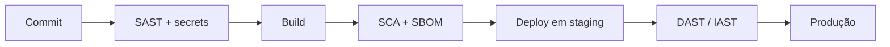

# Ferramentas de Teste de Aplicação - SAST DAST IAST SCA

## Resumo

Quatro técnicas formam o núcleo do teste automatizado de segurança de aplicações. **SAST** (Static Application Security Testing) analisa código-fonte sem executá-lo. **DAST** (Dynamic) testa a aplicação em execução, como um usuário externo. **IAST** (Interactive) instrumenta a aplicação durante testes funcionais para observar fluxos internos. **SCA** (Software Composition Analysis) inventaria dependências de terceiros e cruza com bases de vulnerabilidades. Cada uma enxerga um tipo diferente de problema; combiná-las dá cobertura mais completa.

## Conceitos-chave

- **SAST:** rápido, roda cedo (IDE, commit, PR); gera falsos positivos; exemplos: Semgrep, SonarQube, CodeQL.
- **DAST:** independe de linguagem; encontra problemas de configuração e runtime; exemplos: OWASP ZAP, Nuclei (para checagens baseadas em templates).
- **IAST:** agente dentro da aplicação; precisão alta, mas exige instrumentação e cobertura de testes.
- **SCA:** detecta CVEs em bibliotecas; produz SBOM; exemplos: Dependabot, Snyk, Trivy, OWASP Dependency-Check.
- **SARIF:** formato padrão de saída de análise estática, base para integrações.
- **Falso positivo / falso negativo** e **triagem** como atividades centrais.

## Como funciona



No pipeline, SAST e SCA rodam antes do deploy porque não precisam da aplicação em execução. DAST e IAST exigem um ambiente rodando e, por isso, ficam em staging. O resultado de cada etapa é normalizado (por exemplo em SARIF) e avaliado por um **gate**: se houver achado acima do limiar, o pipeline falha ou abre um ticket.

## Exemplo prático

Contando achados por severidade a partir de um arquivo SARIF (Python):

```python
import json
from collections import Counter

def contar_severidades(caminho: str) -> Counter:
    with open(caminho, encoding="utf-8") as f:
        sarif = json.load(f)
    c = Counter()
    for run in sarif.get("runs", []):
        for r in run.get("results", []):
            # 'level' pode ser error, warning, note ou none
            c[r.get("level", "warning")] += 1
    return c

print(contar_severidades("resultado.sarif"))
```

> [!example] Gate simples
> Falhar o pipeline se `contar_severidades(...)["error"] > 0`.

## Boas práticas

- Comece com regras de alta confiança para ganhar adesão das equipes.
- Execute SAST e SCA em todo PR; DAST em ambientes de teste autorizados.
- Mantenha as bases de vulnerabilidades atualizadas.
- Meça taxa de falsos positivos e ajuste regras.

## Erros comuns

- Rodar DAST contra produção sem autorização nem janela.
- Ignorar vulnerabilidades transitivas.
- Habilitar todas as regras de uma vez e gerar fadiga de alertas.
- Confundir "sem achados" com "sem vulnerabilidades".

> [!warning] Escopo
> Teste dinâmico só em sistemas sob sua responsabilidade e com autorização formal.

## Referências para aprofundar

- Documentação do Semgrep, SonarQube, OWASP ZAP; especificação SARIF 2.1.0 (OASIS).

## Veja também

- [[Panorama de Ferramentas de Segurança]]
- [[SDLC e SSDLC]]
- [[OWASP Top 10 - Integração]]
- [[Ferramentas de Detecção e Resposta - EDR SIEM SOAR]]
- [[MOC - Fundamentos - Integração]]

#seguranca/fundamentos/sast #seguranca/appsec/testes
