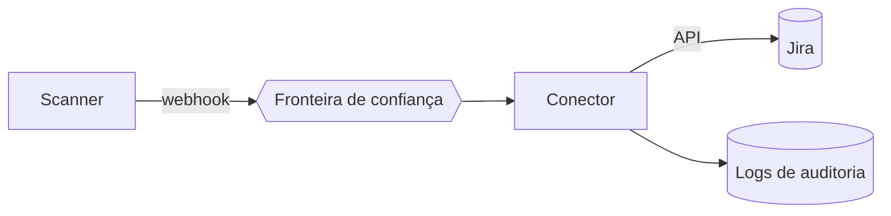

# Modelagem de Ameaças - STRIDE e PASTA

## Resumo

**Modelagem de ameaças** é o processo estruturado de identificar o que pode dar errado em um sistema, priorizar os riscos e definir mitigações, idealmente na fase de design. **STRIDE** é uma taxonomia de seis categorias de ameaça aplicada a elementos de um diagrama de fluxo de dados (DFD). **PASTA** (Process for Attack Simulation and Threat Analysis) é uma metodologia de sete etapas orientada a risco e a objetivos de negócio. Ambas ajudam a transformar intuição em backlog de requisitos de segurança.

## Conceitos-chave

- **STRIDE:** *Spoofing* (falsificação de identidade), *Tampering* (adulteração), *Repudiation* (repúdio), *Information disclosure* (vazamento), *Denial of service* (negação de serviço) e *Elevation of privilege* (elevação de privilégio).
- **DFD:** entidades externas, processos, repositórios de dados, fluxos e **fronteiras de confiança**.
- **PASTA:** (1) objetivos, (2) escopo técnico, (3) decomposição da aplicação, (4) análise de ameaças, (5) análise de vulnerabilidades, (6) modelagem de ataques, (7) análise de risco e impacto.
- **Mitigação, transferência, aceitação ou eliminação** do risco.

## Como funciona

Desenhe o DFD, marque as fronteiras de confiança e percorra cada elemento aplicando as seis categorias. Cada ameaça gera uma mitigação ligada a propriedades de segurança.

| Categoria | Propriedade violada | Mitigação típica |
|---|---|---|
| Spoofing | Autenticidade | mTLS, OAuth 2.0, assinatura de webhook |
| Tampering | Integridade | HMAC, TLS, validação de schema |
| Repudiation | Não repúdio | Logs de auditoria imutáveis |
| Information disclosure | Confidencialidade | Criptografia, mascaramento, RBAC |
| Denial of service | Disponibilidade | Rate limiting, filas, timeouts |
| Elevation of privilege | Autorização | Menor privilégio, validação de escopo |



## Exemplo prático

Registro simples de ameaças em Python, útil para alimentar o backlog:

```python
from dataclasses import dataclass

@dataclass
class Ameaca:
    elemento: str
    categoria: str   # S, T, R, I, D ou E
    descricao: str
    mitigacao: str
    prioridade: int  # 1 (alta) a 3 (baixa)

ameacas = [
    Ameaca("webhook /ingest", "S",
           "Origem falsificada envia alertas falsos",
           "Validar HMAC e IP allowlist", 1),
]
```

> [!example] Pergunta STRIDE
> "Quem pode se passar pelo scanner ao chamar meu endpoint?" Resposta: qualquer um com acesso à rede, se não houver verificação de assinatura.

## Boas práticas

- Faça a modelagem em sessões curtas e recorrentes, com desenvolvedores presentes.
- Revise o modelo a cada mudança arquitetural relevante.
- Converta cada ameaça em item rastreável (ticket) com dono.
- Combine STRIDE com [[MITRE ATT&CK - Integração]] para conectar ameaças a técnicas conhecidas.

## Erros comuns

- Modelar uma vez e nunca atualizar.
- DFD sem fronteiras de confiança.
- Listar ameaças sem priorizar nem mitigar.
- Focar só em ameaças externas e esquecer abuso interno e cadeia de suprimentos.

> [!tip] Ferramentas
> OWASP Threat Dragon e Microsoft Threat Modeling Tool ajudam a documentar DFDs.

## Referências para aprofundar

- *Threat Modeling: Designing for Security*, Adam Shostack.
- OWASP Threat Modeling Cheat Sheet.

## Veja também

- [[SDLC e SSDLC]]
- [[MITRE ATT&CK - Integração]]
- [[Modelo CIA e Princípios de Segurança]]
- [[MOC - Fundamentos - Integração]]

#seguranca/fundamentos/threat-modeling #seguranca/design
