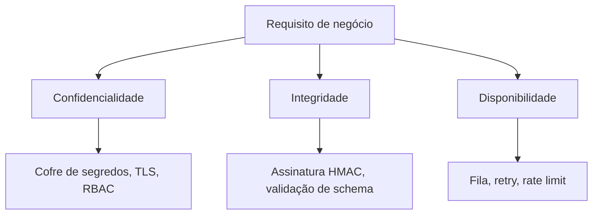

# Modelo CIA e Princípios de Segurança

## Resumo

A tríade **CIA** (Confidentiality, Integrity, Availability) é o modelo mais básico para pensar em segurança da informação. Toda decisão de projeto de uma ferramenta de segurança pode ser avaliada por três perguntas: quem pode ver o dado, quem pode alterá-lo e se ele estará disponível quando necessário. Em integrações, isso se traduz em proteger tokens e logs (confidencialidade), garantir que alertas não sejam adulterados em trânsito (integridade) e evitar que uma falha em um conector derrube o fluxo de resposta (disponibilidade).

## Conceitos-chave

- **Confidencialidade:** acesso restrito a quem tem necessidade. Controles: criptografia, controle de acesso, classificação de dados.
- **Integridade:** os dados não são alterados de forma não autorizada. Controles: hashes, assinaturas, controle de versão, validação de entrada.
- **Disponibilidade:** sistemas e dados acessíveis quando necessários. Controles: redundância, filas, backups, limites de taxa.
- **Princípios de projeto seguro:** menor privilégio, defesa em profundidade, falha segura (*fail secure*), separação de funções, economia de mecanismo, desenho aberto e padrões seguros (*secure by default*).
- **Extensões comuns:** autenticidade, não repúdio e rastreabilidade (accountability).

## Como funciona

Cada pilar gera requisitos concretos. Para um conector que lê achados de um scanner e abre tickets, a **confidencialidade** exige guardar a chave de API em um cofre de segredos e mascará-la nos logs. A **integridade** pede verificar a assinatura do webhook recebido e validar o schema do payload. A **disponibilidade** pede fila com retries e backoff, para que uma indisponibilidade do Jira não perca achados.

Os pilares frequentemente competem: criptografar tudo aumenta latência, e replicar dados amplia a superfície de exposição. O trabalho do engenheiro é decidir o equilíbrio com base no risco.



## Exemplo prático

Verificando a integridade de um payload de webhook com HMAC (Python):

```python
import hmac, hashlib

def assinatura_valida(corpo: bytes, assinatura_recebida: str, segredo: bytes) -> bool:
    # Calcula o HMAC-SHA256 do corpo bruto da requisição
    esperado = hmac.new(segredo, corpo, hashlib.sha256).hexdigest()
    # compare_digest evita ataques de temporização
    return hmac.compare_digest(esperado, assinatura_recebida)
```

> [!example] Mapeamento rápido
> Token vazado em log = falha de confidencialidade. Alerta alterado na fila = falha de integridade. Conector travado por flood = falha de disponibilidade.

## Boas práticas

- Classifique os dados que a ferramenta processa (alertas, credenciais, PII).
- Aplique **menor privilégio** a tokens e contas de serviço.
- Projete para **falhar de forma segura**: na dúvida, negue ou enfileire.
- Combine controles preventivos, detectivos e corretivos (defesa em profundidade).

> [!tip] Pergunta-guia
> Para cada fluxo de dados, pergunte: o que acontece se um atacante ler, alterar ou bloquear isso?

## Erros comuns

- Tratar segurança como sinônimo de confidencialidade e ignorar disponibilidade.
- Confiar na rede interna e dispensar TLS entre serviços.
- Registrar segredos em logs de depuração.
- Usar comparação simples de strings para validar assinaturas.

> [!warning] Cuidado
> Uma ferramenta de segurança indisponível cria um ponto cego; trate-a como sistema crítico.

## Referências para aprofundar

- NIST SP 800-53 e SP 800-160 (engenharia de sistemas seguros).
- Saltzer e Schroeder, *The Protection of Information in Computer Systems*.

## Veja também

- [[SDLC e SSDLC]]
- [[Modelagem de Ameaças - STRIDE e PASTA]]
- [[NIST CSF]]
- [[MOC - Fundamentos - Integração]]

#seguranca/fundamentos/cia #seguranca/principios
