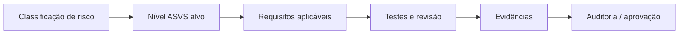

# OWASP ASVS

## Resumo

O **OWASP ASVS** (Application Security Verification Standard) é um catálogo de requisitos de segurança verificáveis para aplicações. Enquanto o [[OWASP Top 10 - Integração]] conscientiza, o ASVS especifica *o que testar* e *a que profundidade*. Ele é organizado em capítulos (autenticação, gestão de sessão, controle de acesso, validação, criptografia, tratamento de erros, logging, APIs etc.) e em **três níveis de verificação**, o que permite adequar o rigor ao risco da aplicação.

## Conceitos-chave

- **Nível 1:** requisitos básicos, testáveis de forma largamente automatizada; adequado a todas as aplicações.
- **Nível 2:** recomendado para aplicações que tratam dados sensíveis; cobre a maioria dos casos corporativos.
- **Nível 3:** aplicações de alto valor ou criticidade (finanças, saúde, infraestrutura).
- **Requisito:** item numerado (ex.: V2.1.1) com descrição objetiva e mapeamento a CWE.
- **Verificação:** revisão de código, teste manual, testes automatizados e evidências.

## Como funciona

O uso típico começa escolhendo o nível-alvo com base na classificação de risco. A equipe seleciona os capítulos aplicáveis, transforma requisitos em critérios de aceite e acopla testes automatizados ao pipeline sempre que possível. O resultado é uma matriz de rastreabilidade: requisito → controle → evidência.



Para ferramentas de segurança que expõem API, os capítulos de API, autenticação, controle de acesso, comunicação e configuração são prioritários.

## Exemplo prático

Matriz de rastreabilidade mínima em YAML, guardada no repositório:

```yaml
requisitos:
  - id: V2.1.1
    descricao: "Senhas e segredos com tamanho mínimo adequado"
    controle: "Tokens gerados com 256 bits via secrets.token_urlsafe"
    evidencia: "tests/test_tokens.py"
    status: atendido
  - id: V13.1.1
    descricao: "Validação de entrada em todas as rotas da API"
    controle: "Schemas pydantic em cada endpoint"
    evidencia: "tests/test_schemas.py"
    status: parcial
```

> [!example] Automação
> Cada item `evidencia` pode apontar para um teste executado no CI, mantendo a matriz sempre auditável.

## Boas práticas

- Defina o nível por serviço, não para toda a organização de uma vez.
- Marque requisitos não aplicáveis com justificativa.
- Reavalie ao mudar de versão do ASVS.
- Combine com testes automatizados e revisão manual.

## Erros comuns

- Tentar atender ao Nível 3 sem priorização.
- Preencher a matriz sem evidências reais.
- Usar ASVS apenas como checklist de fim de projeto.

> [!question] Reflexão
> Seu conector processa dados sensíveis? Isso muda o nível-alvo?

## Referências para aprofundar

- owasp.org/www-project-application-security-verification-standard.

## Veja também

- [[OWASP Top 10 - Integração]]
- [[SDLC e SSDLC]]
- [[Ferramentas de Teste de Aplicação - SAST DAST IAST SCA]]
- [[MOC - Fundamentos - Integração]]

#seguranca/fundamentos/owasp #seguranca/appsec/asvs
