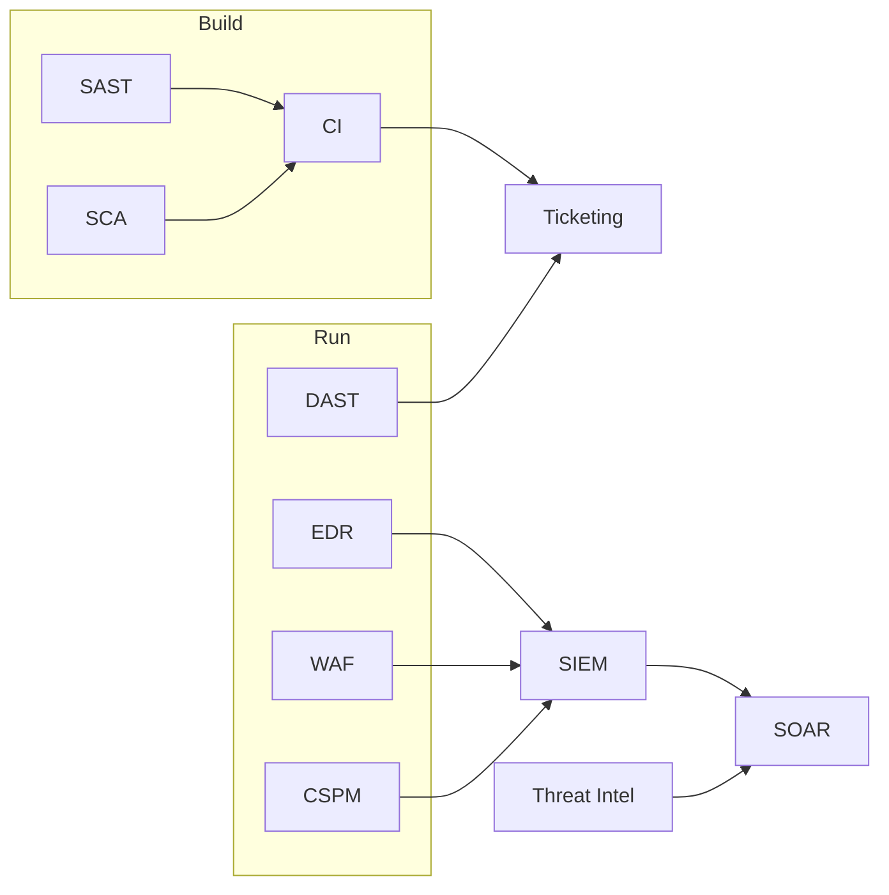

# Panorama de Ferramentas de Segurança

## Resumo

Ferramentas de segurança se dividem em categorias conforme **onde** atuam no ciclo de vida e **o que** observam: código-fonte, dependências, aplicação em execução, endpoints, rede, nuvem ou eventos. Conhecer o panorama é pré-requisito para integrar: cada categoria produz um tipo de dado (achados, alertas, inventários, eventos) e oferece superfícies de integração (API, webhook, syslog, arquivos SARIF). Esta nota apresenta o mapa geral; as três notas seguintes detalham os grupos.

## Conceitos-chave

- **Teste de aplicação:** SAST, DAST, IAST, SCA — veja [[Ferramentas de Teste de Aplicação - SAST DAST IAST SCA]].
- **Detecção e resposta:** EDR, SIEM, SOAR — veja [[Ferramentas de Detecção e Resposta - EDR SIEM SOAR]].
- **Postura e proteção:** CSPM, WAF, scanners de vulnerabilidade, gestão de segredos — veja [[Ferramentas de Postura e Proteção - CSPM WAF Scanners e Segredos]].
- **Complementares:** threat intelligence (MISP, OpenCTI), ticketing, mensageria.
- **Tipos de saída:** achado (finding), alerta, evento, inventário, relatório, SBOM.

## Como funciona

As ferramentas se organizam em camadas que alimentam umas às outras. Achados de scanners vão para ticketing; eventos de endpoints vão para o SIEM; alertas do SIEM disparam playbooks do SOAR; indicadores de threat intelligence enriquecem tudo.

> [!tip] Pensamento de integrador
> Para cada ferramenta, identifique: formato de saída, mecanismo de entrega (push ou pull), autenticação e limites de taxa.

## Exemplo prático

Tabela de decisão por pergunta:

| Pergunta | Categoria |
|---|---|
| Há falhas no meu código? | SAST |
| Minhas dependências têm CVE? | SCA |
| A aplicação em execução é vulnerável? | DAST / IAST |
| O que acontece nos hosts? | EDR |
| Onde correlaciono eventos? | SIEM |
| Como automatizo a resposta? | SOAR |
| A nuvem está mal configurada? | CSPM |
| Segredos vazaram no repositório? | Secrets scanning |

> [!example] Inventário em código
> Manter um dicionário `ferramenta → formato de saída` ajuda a planejar adaptadores de normalização.

## Boas práticas

- Escolha ferramentas pelo problema, não pela moda.
- Prefira formatos abertos (SARIF, OCSF, STIX) para reduzir acoplamento.
- Evite sobreposição excessiva, que gera ruído e custo.
- Documente o fluxo de dados entre ferramentas.

## Erros comuns

- Comprar ferramentas sem integração planejada.
- Ignorar o custo operacional de falsos positivos.
- Tratar a ferramenta como solução em si, sem processo.

> [!warning] Armadilha
> Ferramenta sem dono e sem processo de triagem vira fonte de alertas ignorados.

## Referências para aprofundar

- Mapeamentos NIST CSF ↔ ferramentas e guias do CIS.

## Veja também

- [[Ferramentas de Teste de Aplicação - SAST DAST IAST SCA]]
- [[Ferramentas de Detecção e Resposta - EDR SIEM SOAR]]
- [[Ferramentas de Postura e Proteção - CSPM WAF Scanners e Segredos]]
- [[CIS Controls]]
- [[MOC - Fundamentos - Integração]]

#seguranca/fundamentos/ferramentas #seguranca/panorama
