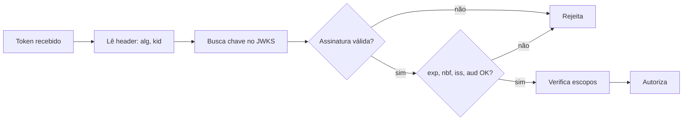

# JWT

## Resumo

**JWT** (JSON Web Token, RFC 7519) é um formato compacto para transportar *claims* (afirmações) entre partes, geralmente assinado (JWS) e, às vezes, criptografado (JWE). É usado como access token e ID token em [[OAuth 2.0 e OIDC]]. Sua força é permitir validação **sem consultar o emissor**, bastando verificar a assinatura com a chave pública. Sua fraqueza é que, uma vez emitido, é difícil revogar antes de expirar, e erros de validação (algoritmo, audiência, expiração) viram vulnerabilidades sérias.

## Conceitos-chave

- **Estrutura:** `header.payload.signature`, cada parte em Base64URL.
- **Claims registradas:** `iss` (emissor), `sub` (sujeito), `aud` (audiência), `exp`, `nbf`, `iat`, `jti`.
- **Algoritmos:** HS256 (segredo compartilhado), RS256 e ES256 (chave assimétrica); evite `none`.
- **JWKS:** conjunto de chaves públicas publicado pelo emissor, com `kid`.
- **JWS vs. JWE:** assinado (integridade) vs. criptografado (confidencialidade).
- **Importante:** o payload é apenas codificado, **não é secreto**.

## Como funciona



A validação correta **fixa o algoritmo esperado** na configuração, em vez de confiar no `alg` do cabeçalho, e verifica emissor e audiência. Para revogação, usam-se tokens de vida curta, listas de `jti` revogados ou introspecção.

## Exemplo prático

Validação com a biblioteca PyJWT (Python):

```python
import jwt   # pip install pyjwt[crypto]

def validar(token: str, chave_publica: str) -> dict:
    return jwt.decode(
        token,
        chave_publica,
        algorithms=["RS256"],               # fixa o algoritmo
        audience="api-achados",             # exige aud correto
        issuer="https://auth.exemplo.com",  # exige iss correto
        options={"require": ["exp", "iss", "aud"]},
    )
```

> [!tip] Inspeção
> Para estudo, decodifique o payload em Base64URL e observe os claims; nunca cole tokens reais em sites de terceiros.

## Boas práticas

- Tokens de acesso com vida curta (minutos).
- Chaves assimétricas e rotação com `kid`.
- Valide sempre assinatura, `exp`, `iss`, `aud` e escopos.
- Não armazene dados sensíveis no payload.

## Erros comuns

- Aceitar `alg: none` ou deixar o token escolher o algoritmo.
- Usar o mesmo segredo HS256 em vários serviços.
- Não validar `aud`, aceitando tokens de outras APIs.
- Guardar JWT em armazenamento acessível a scripts em apps web sem proteção.

> [!warning] Confusão
> JWT é um formato, não um protocolo de autenticação; a segurança vem de como é emitido e validado.

## Referências para aprofundar

- RFC 7519, RFC 7515, RFC 8725 (JWT Best Current Practices).

## Veja também

- [[OAuth 2.0 e OIDC]]
- [[Escopos e Menor Privilégio]]
- [[API Keys e Gestão de Credenciais]]
- [[mTLS]]
- [[MOC - APIs e Autenticação]]

#seguranca/api/jwt #seguranca/autenticacao/tokens
