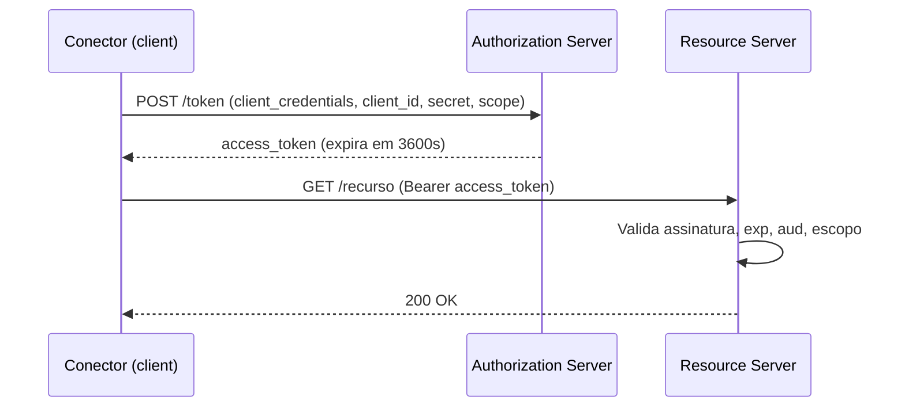

# OAuth 2.0 e OIDC

## Resumo

**OAuth 2.0** é um framework de **autorização delegada**: permite que uma aplicação acesse recursos em nome de um usuário (ou dela mesma) sem receber a senha, usando *access tokens* de escopo e vida limitados. **OpenID Connect (OIDC)** é uma camada de **autenticação** sobre OAuth 2.0 que adiciona o *ID token* (um [[JWT]]) com a identidade do usuário. Integrações máquina a máquina (conectores, pipelines) usam principalmente o fluxo *client credentials*; aplicações interativas usam *authorization code com PKCE*.

## Conceitos-chave

- **Papéis:** resource owner, client, authorization server, resource server.
- **Fluxos (grants):** authorization code (+ PKCE), client credentials, device code, refresh token. Os fluxos *implicit* e *password* são desaconselhados.
- **Tokens:** access token (curto), refresh token (longo, protegido), ID token (OIDC).
- **Escopos:** permissões solicitadas; veja [[Escopos e Menor Privilégio]].
- **PKCE:** protege o code flow contra interceptação do código.
- **Discovery e JWKS:** metadados e chaves públicas publicados pelo provedor.
- **Introspecção e revogação** de tokens.

## Como funciona



O conector solicita o token, o armazena **em memória** até perto da expiração e o renova de forma proativa. O resource server valida assinatura, emissor (`iss`), audiência (`aud`), expiração (`exp`) e escopos antes de atender.

## Exemplo prático

Obtendo e reutilizando token via client credentials (Python):

```python
import time, requests

class TokenProvider:
    def __init__(self, url, client_id, client_secret, scope):
        self.url, self.cid, self.sec, self.scope = url, client_id, client_secret, scope
        self.token, self.expira = None, 0

    def obter(self) -> str:
        if time.time() < self.expira - 60:      # renova 60s antes
            return self.token
        r = requests.post(self.url, data={
            "grant_type": "client_credentials",
            "scope": self.scope,
        }, auth=(self.cid, self.sec), timeout=10)
        r.raise_for_status()
        dados = r.json()
        self.token = dados["access_token"]
        self.expira = time.time() + dados["expires_in"]
        return self.token
```

> [!tip] Cache
> Reutilize o token até expirar; pedir um novo a cada chamada sobrecarrega o servidor de autorização.

## Boas práticas

- Use authorization code com **PKCE** para apps interativos.
- Tokens de acesso curtos; refresh tokens com rotação.
- Valide `iss`, `aud`, `exp` e escopo em todo resource server.
- Guarde `client_secret` em cofre; considere autenticação do cliente por mTLS ou `private_key_jwt`.

## Erros comuns

- Usar fluxo implicit ou password.
- Tratar o access token como identidade do usuário (isso é papel do ID token).
- Não validar a audiência, aceitando tokens emitidos para outra API.
- Logar tokens.

> [!warning] Confusão comum
> OAuth 2.0 sozinho não autentica o usuário; para login use OIDC.

## Referências para aprofundar

- RFC 6749, RFC 7636 (PKCE), RFC 9700 (Security BCP), especificação OpenID Connect Core.

## Veja também

- [[JWT]]
- [[Escopos e Menor Privilégio]]
- [[API Keys e Gestão de Credenciais]]
- [[mTLS]]
- [[MOC - APIs e Autenticação]]

#seguranca/api/oauth #seguranca/api/oidc #seguranca/autenticacao
