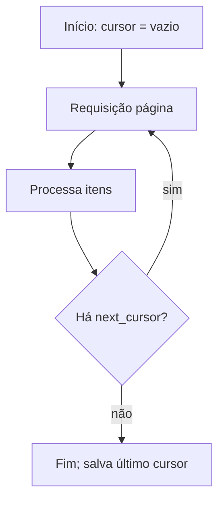

# Paginação e Versionamento

## Resumo

Ao integrar com ferramentas de segurança é comum consumir milhares de achados, eventos ou CVEs. APIs não os entregam de uma vez: usam **paginação**. E, como ferramentas evoluem, as APIs mudam; o **versionamento** protege integrações existentes de quebras. Dominar os dois é o que separa um conector que "funciona no teste" de outro que coleta todos os dados de forma confiável por anos. Paginação mal feita perde dados ou entra em laço infinito; versionamento ignorado quebra a integração sem aviso.

## Conceitos-chave

- **Offset/limit:** simples, mas instável se os dados mudam durante a leitura e lento em grandes volumes.
- **Cursor (keyset):** usa um marcador opaco (`next_cursor`) ou o último id; estável e eficiente.
- **Link headers e `next`:** a API informa a próxima página (RFC 8288).
- **Tamanho de página** (`per_page`) e limites máximos.
- **Versionamento por URL** (`/v2/`), por cabeçalho ou por data.
- **Compatibilidade retroativa:** adicionar campos é seguro; remover ou mudar tipos quebra.
- **Depreciação:** cabeçalhos `Deprecation` e `Sunset`.

## Como funciona



O coletor persiste o último cursor ou timestamp processado para retomar após falhas (coleta incremental). Combine com [[Idempotência]], pois uma retomada pode reler itens. Para versionamento, fixe explicitamente a versão da API no cliente e acompanhe os avisos de depreciação do fornecedor.

## Exemplo prático

Iterador de páginas com cursor (Python):

```python
import requests

def iterar_achados(base: str, token: str, por_pagina: int = 100):
    cursor = None
    while True:
        params = {"limit": por_pagina}
        if cursor:
            params["cursor"] = cursor
        r = requests.get(f"{base}/v2/achados", params=params,
                         headers={"Authorization": f"Bearer {token}"}, timeout=15)
        r.raise_for_status()
        corpo = r.json()
        yield from corpo["itens"]
        cursor = corpo.get("next_cursor")
        if not cursor:                # fim da coleta
            break
```

> [!tip] Memória
> Use `yield` para processar página a página sem carregar tudo na memória.

## Boas práticas

- Prefira paginação por cursor para coleções grandes ou mutáveis.
- Limite o número máximo de páginas por execução para evitar laços infinitos.
- Fixe a versão da API e teste contra mudanças.
- Monitore avisos de depreciação.

## Erros comuns

- Paginar por offset em dados que mudam e perder ou duplicar itens.
- Não tratar a última página vazia.
- Usar a versão "latest" implícita.
- Ignorar [[Rate Limiting]] ao varrer muitas páginas.

> [!warning] Dados perdidos
> Sem cursor persistido, uma falha no meio da coleta obriga a recomeçar do zero.

## Referências para aprofundar

- RFC 8288 (Web Linking); guias de paginação de APIs do GitHub e do Stripe.

## Veja também

- [[REST e Design de APIs de Segurança]]
- [[OpenAPI]]
- [[Retries com Backoff e Tratamento de Falhas]]
- [[Normalização de Dados - OCSF ECS CEF STIX e TAXII]]
- [[MOC - APIs e Autenticação]]

#seguranca/api/paginacao #seguranca/api/versionamento
