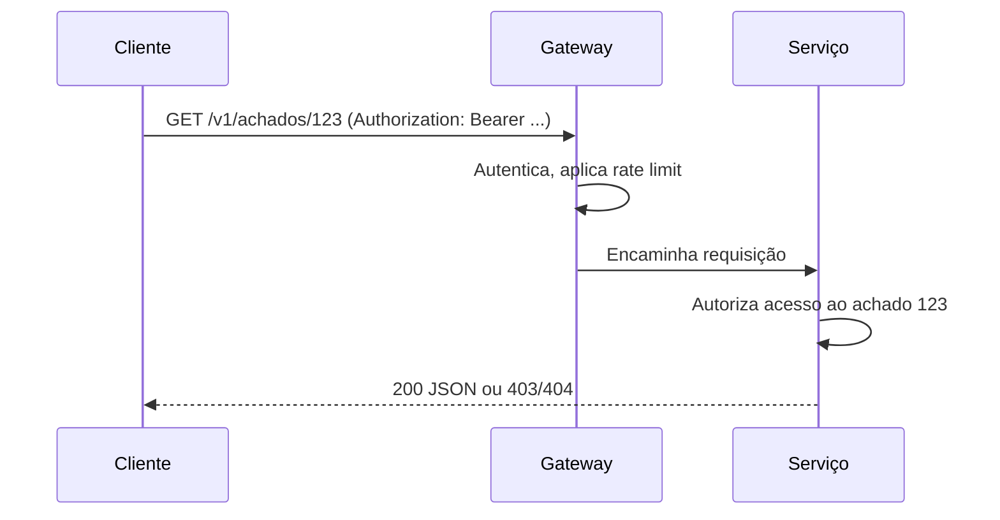

# REST e Design de APIs de Segurança

## Resumo

**REST** (Representational State Transfer) é um estilo arquitetural em que recursos são identificados por URLs e manipulados com métodos HTTP padronizados. É a base da imensa maioria das APIs de ferramentas de segurança: Jira, GitHub, VirusTotal, Splunk, TheHive. Entender REST vai além de saber chamar um endpoint: envolve semântica de métodos, códigos de status, cabeçalhos, formatos de erro e, principalmente, os riscos de segurança de cada decisão de desenho, catalogados no OWASP API Security Top 10.

## Conceitos-chave

- **Recursos e verbos:** `GET` lê, `POST` cria, `PUT` substitui, `PATCH` altera parcialmente, `DELETE` remove.
- **Códigos de status:** 2xx sucesso, 3xx redirecionamento, 4xx erro do cliente (400, 401, 403, 404, 409, 429), 5xx erro do servidor.
- **Stateless:** cada requisição carrega o necessário (token, parâmetros).
- **Cabeçalhos:** `Authorization`, `Content-Type`, `Accept`, `ETag`, `Retry-After`.
- **Autorização por objeto (BOLA):** verificar acesso ao recurso específico, não só ao endpoint.
- **Negociação de conteúdo e erros padronizados** (por exemplo, RFC 9457, *problem details*).

## Como funciona

Uma chamada REST típica atravessa TLS, autenticação, autorização, validação e só então a lógica. Cada camada deve falhar de forma explícita e consistente.



Do lado cliente, escreva um *client* fino que centraliza URL base, timeout, cabeçalhos, retries e mapeamento de erros, seguindo o [[Padrão Adapter e Connector]].

## Exemplo prático

Cliente REST com sessão, timeout e tratamento de erro (Python):

```python
import requests

class ClienteAPI:
    def __init__(self, base_url: str, token: str):
        self.base = base_url.rstrip("/")
        self.s = requests.Session()
        self.s.headers.update({
            "Authorization": f"Bearer {token}",
            "Accept": "application/json",
        })

    def obter(self, caminho: str, **params):
        r = self.s.get(f"{self.base}{caminho}", params=params, timeout=(3, 15))
        if r.status_code == 429:
            raise RuntimeError("limite de taxa atingido")
        r.raise_for_status()
        return r.json()
```

> [!example] BOLA
> `GET /achados/124` retornando dados de outro tenant é falha de autorização por objeto, mesmo com token válido.

## Boas práticas

- Use HTTPS sempre e HSTS no servidor.
- Valide entrada (tipos, tamanhos, formatos) e rejeite campos inesperados.
- Retorne erros sem expor detalhes internos (stack traces).
- Aplique [[Rate Limiting]] e limite tamanho de payload.
- Não coloque segredos em URLs (ficam em logs).

## Erros comuns

- Autenticar, mas não autorizar por objeto.
- Expor dados em excesso nas respostas (excessive data exposure).
- Aceitar `PUT` e `PATCH` sem validar campos mutáveis (mass assignment).
- Usar `GET` para operações que mudam estado.

> [!warning] Referência
> Consulte o OWASP API Security Top 10 como checklist do desenho de qualquer API.

## Referências para aprofundar

- OWASP API Security Top 10; RFC 9110 (HTTP Semantics); RFC 9457.

## Veja também

- [[OAuth 2.0 e OIDC]]
- [[Paginação e Versionamento]]
- [[OpenAPI]]
- [[OWASP Top 10 - Integração]]
- [[MOC - APIs e Autenticação]]

#seguranca/api/rest #seguranca/integracao/api
