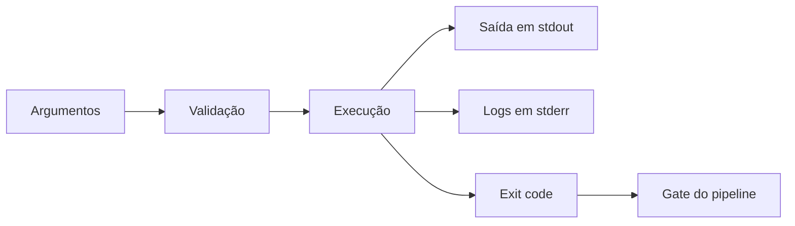

# CLI de Segurança

## Resumo

A **CLI** (command-line interface) é a forma mais comum de entregar ferramentas de segurança: roda em terminal, em cron, em pipeline de CI e em containers. Uma boa CLI é previsível: argumentos claros, saída legível por humanos **e** por máquinas, e **códigos de saída** que permitem usá-la como *gate* em pipelines. Python oferece `argparse` (biblioteca padrão), Click e Typer; Go oferece `flag` e bibliotecas como Cobra.

## Conceitos-chave

- **Subcomandos:** `ferramenta scan`, `ferramenta enviar`.
- **Argumentos e opções:** obrigatórios, opcionais, `--help` completo.
- **Saída:** `--format text|json|sarif`; resultados em *stdout*, logs em *stderr*.
- **Códigos de saída:** `0` sucesso, `1` achados acima do limiar, `2` erro de uso ou execução.
- **Entrada via stdin** para uso em pipes.
- **Segredos:** nunca por argumento de linha de comando (aparecem em `ps` e no histórico); use variáveis de ambiente ou arquivo protegido.
- **Modo `--dry-run`** para ações com efeito colateral.

## Como funciona



O pipeline interpreta o exit code: se `1`, falha a etapa. Por isso a ferramenta deve distinguir "encontrei problemas" (1) de "quebrei" (2). Separar stdout de stderr permite redirecionar o JSON para um arquivo sem misturar mensagens de log.

## Exemplo prático

CLI com `argparse` que lê um relatório e falha se houver severidade acima do limiar:

```python
import argparse, json, sys

ORDEM = {"baixa": 1, "media": 2, "alta": 3, "critica": 4}

def main(argv=None) -> int:
    p = argparse.ArgumentParser(prog="gate", description="Gate de severidade")
    p.add_argument("arquivo", help="relatório JSON de achados")
    p.add_argument("--limiar", choices=ORDEM, default="alta")
    p.add_argument("--dry-run", action="store_true")
    args = p.parse_args(argv)

    try:
        with open(args.arquivo, encoding="utf-8") as f:
            achados = json.load(f)
    except (OSError, json.JSONDecodeError) as e:
        print(f"erro: {e}", file=sys.stderr)
        return 2                                 # erro de execução

    ruins = [a for a in achados if ORDEM[a["severidade"]] >= ORDEM[args.limiar]]
    print(json.dumps({"total": len(achados), "acima_do_limiar": len(ruins)}))
    return 0 if (not ruins or args.dry_run) else 1

if __name__ == "__main__":
    sys.exit(main())
```

## Boas práticas

- Retorne códigos de saída documentados e estáveis.
- Valide entradas e normalize caminhos antes de usá-los.
- Ofereça saída JSON para automação e texto para humanos.
- Evite imprimir segredos; mascare em mensagens de erro.

## Erros comuns

- Receber token via `--token` (vaza em histórico e listagem de processos).
- Misturar logs e resultados no stdout.
- Retornar sempre `0`, quebrando a lógica de gate.
- Executar comandos de shell montados com entrada do usuário.

> [!warning] Injeção de comando
> Nunca use `shell=True` com dados externos; passe argumentos como lista em `subprocess.run`.

## Referências para aprofundar

- Documentação do argparse, Click, Typer e Cobra; *Command Line Interface Guidelines* (clig.dev).

## Veja também

- [[Estrutura de Projeto]]
- [[Parsing de Formatos - SARIF JSON e XML]]
- [[Logging e Configuração Segura]]
- [[Ferramentas de Teste de Aplicação - SAST DAST IAST SCA]]
- [[MOC - Desenvolvimento de Ferramentas]]

#seguranca/desenvolvimento/cli #seguranca/devsecops/automacao
