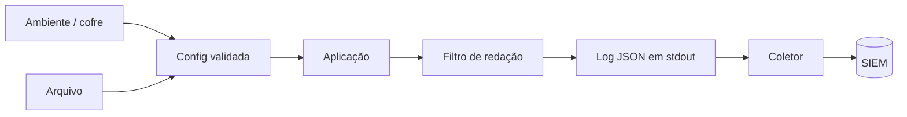

# Logging e Configuração Segura

## Resumo

**Logging** é a memória operacional da ferramenta: registra o que aconteceu, para depuração, auditoria e detecção. **Configuração segura** define como parâmetros e segredos chegam ao programa. Ambos precisam de cuidado: logs com tokens e dados pessoais viram vazamentos; configuração com padrões inseguros vira exposição. Seguindo o princípio de *config via ambiente* (12-factor), a ferramenta recebe parâmetros por variáveis de ambiente, arquivos protegidos ou cofres, e emite logs estruturados em stdout para serem coletados por uma plataforma central.

## Conceitos-chave

- **Níveis:** DEBUG, INFO, WARNING, ERROR, CRITICAL.
- **Log estruturado:** JSON com campos fixos (`timestamp`, `nivel`, `evento`, `correlation_id`).
- **Correlation ID:** liga logs de uma mesma requisição ou evento.
- **Redação (redaction):** filtros que mascaram tokens, senhas e dados pessoais.
- **Ordem de precedência da configuração:** padrões seguros < arquivo < ambiente < argumentos.
- **Validação de configuração na partida** (falhar cedo).
- **Log de auditoria:** quem fez o quê, quando, com resultado, separado do log técnico.

## Como funciona



A configuração é carregada e validada uma vez na inicialização; valores ausentes ou inválidos interrompem a execução imediatamente. Os logs passam por um filtro que remove padrões sensíveis antes de sair do processo, e seguem para o coletor central.

## Exemplo prático

Logging JSON com redação (Python):

```python
import json, logging, re, sys

PADRAO = re.compile(r"(token|senha|api[_-]?key)=\S+", re.IGNORECASE)

class FiltroRedacao(logging.Filter):
    def filter(self, record):
        record.msg = PADRAO.sub(r"\1=***", str(record.msg))   # mascara valores
        return True

class FormatoJSON(logging.Formatter):
    def format(self, record):
        return json.dumps({
            "ts": self.formatTime(record, "%Y-%m-%dT%H:%M:%S%z"),
            "nivel": record.levelname,
            "evento": record.getMessage(),
            "logger": record.name,
        }, ensure_ascii=False)

h = logging.StreamHandler(sys.stdout)
h.setFormatter(FormatoJSON())
h.addFilter(FiltroRedacao())
log = logging.getLogger("conector")
log.addHandler(h); log.setLevel(logging.INFO)

log.info("chamando api token=ABC123")   # saída: token=***
```

Configuração validada:

```python
import os
from dataclasses import dataclass

@dataclass(frozen=True)
class Config:
    jira_url: str
    timeout: float = 10.0

def carregar() -> Config:
    url = os.environ.get("JIRA_URL")
    if not url or not url.startswith("https://"):
        raise SystemExit("JIRA_URL ausente ou sem https")   # falha cedo
    return Config(jira_url=url, timeout=float(os.environ.get("TIMEOUT", "10")))
```

## Boas práticas

- Padrões seguros: TLS ligado, verificação de certificado ativa, modo debug desligado.
- Nunca registre corpo completo de requisições com credenciais.
- Separe log técnico de log de auditoria e proteja a integridade deste.
- Respeite a LGPD: minimize dados pessoais em logs e defina retenção.

## Erros comuns

- Logar tokens, senhas, cabeçalhos `Authorization` ou PII.
- Mensagens de log com entrada do usuário sem sanitizar (injeção de linhas falsas, *log forging*).
- Configuração com valores padrão inseguros "para facilitar".
- Nível DEBUG ligado em produção.

> [!warning] Log forging
> Quebras de linha em dados externos podem forjar entradas falsas em logs de texto; prefira JSON, que escapa automaticamente.

## Referências para aprofundar

- *The Twelve-Factor App*; OWASP Logging Cheat Sheet; LGPD (Lei 13.709/2018).

## Veja também

- [[CLI de Segurança]]
- [[Empacotamento e Containers]]
- [[API Keys e Gestão de Credenciais]]
- [[OWASP ASVS]]
- [[MOC - Desenvolvimento de Ferramentas]]

#seguranca/desenvolvimento/logging #seguranca/desenvolvimento/configuracao
