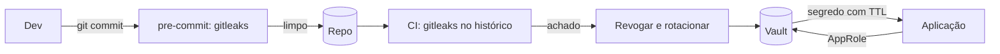

# Integração com Gestão de Segredos - Vault e gitleaks

## Resumo

Duas peças complementares tratam segredos: **HashiCorp Vault** *guarda e entrega* credenciais de forma controlada (KV, segredos dinâmicos, PKI, auditoria), e o **gitleaks** *detecta* segredos que escaparam para repositórios, histórico git e arquivos. Integrar ambos fecha o ciclo: a aplicação busca credenciais no Vault em vez de tê-las no código, e o gitleaks no pre-commit e no CI impede que cheguem ao repositório. Quando algo vaza, o fluxo é detectar, revogar e rotacionar.

## Conceitos-chave

- **Vault:** autenticação (AppRole, Kubernetes, OIDC), políticas por caminho, *secrets engines* (KV v2, database, AWS), *leases* e TTL, log de auditoria.
- **AppRole:** `role_id` (identificador) + `secret_id` (segredo de curta duração) para aplicações.
- **Segredos dinâmicos:** credenciais geradas sob demanda e revogadas ao expirar.
- **gitleaks:** regras regex + entropia; modos para diretório, histórico git e stdin; relatórios JSON/SARIF; opção de redação do valor.
- **Allowlist e baseline** para falsos positivos e legado.

## Como funciona



A aplicação se autentica no Vault, recebe um token com política mínima e lê o segredo; o token tem TTL e é renovado ou descartado. O relatório do gitleaks alimenta ticket e playbook de rotação.

## Exemplo prático

Lendo um segredo do Vault com AppRole (Python, biblioteca `hvac`):

```python
import os, hvac

def segredo_jira() -> str:
    cli = hvac.Client(url=os.environ["VAULT_ADDR"])
    cli.auth.approle.login(
        role_id=os.environ["VAULT_ROLE_ID"],
        secret_id=os.environ["VAULT_SECRET_ID"],   # injetado pelo orquestrador
    )
    resp = cli.secrets.kv.v2.read_secret_version(
        path="conectores/jira", mount_point="secret")
    return resp["data"]["data"]["api_token"]       # KV v2 aninha em data.data
```

Política mínima do Vault (HCL):

```hcl
path "secret/data/conectores/jira" {
  capabilities = ["read"]
}
```

Varredura com gitleaks e relatório sem expor o valor:

```bash
gitleaks detect --source . --redact --report-format json --report-path gl.json
```

> [!warning] Versões
> Subcomandos do gitleaks mudaram entre versões (`detect`, `git`, `dir`); consulte `gitleaks --help` da versão instalada.

## Boas práticas

- Use `--redact` para que relatórios não reproduzam o segredo.
- Defina TTL curto para tokens do Vault e use políticas por caminho.
- Habilite o *audit device* do Vault e envie seus logs ao SIEM.
- Trate todo segredo detectado como comprometido: revogue e rotacione.

## Erros comuns

- Achar que apagar o commit resolve; o histórico e forks mantêm o segredo.
- Salvar o `secret_id` do AppRole no repositório.
- Token raiz do Vault usado por aplicações.
- Relatórios do gitleaks com o segredo em texto claro anexados a tickets.

> [!question] Fluxo
> Quem é avisado, e em quanto tempo, quando um segredo vaza? Automatize o aviso.

## Referências para aprofundar

- HashiCorp Vault docs (AppRole, KV v2, Audit); documentação do gitleaks.

## Veja também

- [[API Keys e Gestão de Credenciais]]
- [[Ferramentas de Postura e Proteção - CSPM WAF Scanners e Segredos]]
- [[Integração com SAST e SCA - Semgrep SonarQube Dependabot e Snyk]]
- [[Integração com Ticketing - Jira e GitHub Issues]]
- [[MOC - Integração com Ferramentas de Segurança]]

#seguranca/integracao/segredos #seguranca/integracao/vault #seguranca/integracao/gitleaks
