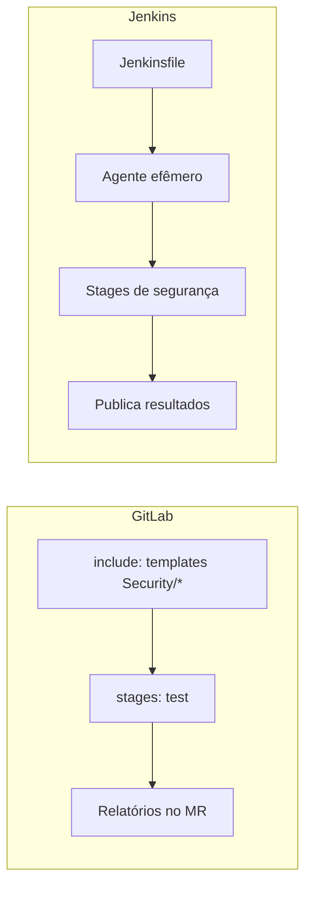

# GitLab CI e Jenkins

## Resumo

**GitLab CI/CD** e **Jenkins** são alternativas muito usadas ao GitHub Actions, sobretudo em ambientes corporativos e *self-hosted*. O GitLab CI define pipelines em `.gitlab-ci.yml` e oferece templates prontos de segurança (SAST, Secret Detection, Dependency Scanning, Container Scanning). O Jenkins é um servidor de automação extensível por plugins, com pipelines declarativos em `Jenkinsfile`. Os conceitos de segurança são os mesmos (gates, segredos, privilégio mínimo), mas cada plataforma tem armadilhas próprias.

## Conceitos-chave

- **GitLab CI:** `stages`, `jobs`, `rules`, `artifacts: reports`, `include` de templates, variáveis *masked* e *protected*, runners compartilhados ou dedicados.
- **Jenkins:** controller e agentes, pipeline declarativo, *shared libraries*, `withCredentials`, plugins (superfície de ataque!).
- **Segredos:** variáveis protegidas por branch (GitLab) e credenciais do Jenkins com escopo; evite ecoar valores.
- **Isolamento:** agentes efêmeros (containers) em vez de agentes persistentes.
- **Relatórios nativos:** o GitLab exibe achados no merge request via `artifacts:reports`.

## Como funciona



No GitLab, a inclusão de templates habilita rapidamente varreduras padronizadas. No Jenkins, o ganho vem de *shared libraries* que encapsulam as etapas de segurança, para que todos os projetos usem a mesma implementação revisada.

## Exemplo prático

GitLab CI com templates de segurança e job customizado:

```yaml
stages: [test, seguranca]

include:
  - template: Security/SAST.gitlab-ci.yml
  - template: Security/Secret-Detection.gitlab-ci.yml

trivy-imagem:
  stage: seguranca
  image:
    name: aquasec/trivy:latest      # em produção, fixe a versão/digest
    entrypoint: [""]
  script:
    - trivy image --exit-code 1 --severity CRITICAL "$CI_REGISTRY_IMAGE:$CI_COMMIT_SHA"
  rules:
    - if: $CI_PIPELINE_SOURCE == "merge_request_event"
```

Jenkinsfile declarativo com credencial protegida:

```groovy
pipeline {
  agent { docker { image 'python:3.12-slim' } }
  stages {
    stage('Testes') { steps { sh 'pip install -e . && pytest' } }
    stage('Segurança') {
      steps {
        withCredentials([string(credentialsId: 'sonar-token', variable: 'SONAR_TOKEN')]) {
          sh 'sonar-scanner -Dsonar.token=$SONAR_TOKEN'
        }
      }
    }
  }
}
```

## Boas práticas

- Use agentes efêmeros e rede segmentada para runners.
- Marque variáveis sensíveis como *masked* e *protected*.
- No Jenkins, minimize plugins, mantenha-os atualizados e restrinja permissões (RBAC).
- Centralize a lógica de segurança em templates ou shared libraries.

## Erros comuns

- Runners compartilhados com acesso a produção.
- Variáveis não protegidas disponíveis em pipelines de branches arbitrárias.
- Jenkins desatualizado exposto na internet.
- Scripts `sh` com interpolação de entradas externas.

> [!warning] Plugins do Jenkins
> Cada plugin é código com acesso ao servidor de build; avalie necessidade e manutenção antes de instalar.

## Referências para aprofundar

- GitLab Docs: Application Security; Jenkins Security Hardening; CIS Software Supply Chain Security Guide.

## Veja também

- [[GitHub Actions]]
- [[Security Gates e Shift-Left]]
- [[Pré-commit Hooks]]
- [[Assinatura de Artefatos - Sigstore e cosign]]
- [[MOC - DevSecOps e CI-CD]]

#seguranca/devsecops/gitlab-ci #seguranca/devsecops/jenkins #seguranca/ci-cd
