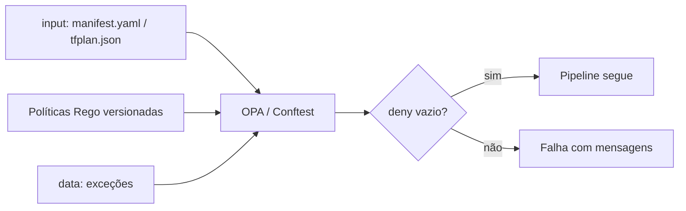

# Políticas como Código - OPA e Rego

## Resumo

**Políticas como código** (policy as code) expressam regras de conformidade e segurança em linguagem executável, versionada e testável. O **Open Policy Agent (OPA)** é um motor de políticas de propósito geral; suas regras são escritas em **Rego**, uma linguagem declarativa. A entrada é um documento JSON (um plano de Terraform, um manifesto Kubernetes, uma requisição de API) e a saída é uma decisão (permitir/negar, com mensagens). O **Conftest** aplica Rego a arquivos de configuração no CI, e o **Gatekeeper** aplica políticas na admissão do Kubernetes.

## Conceitos-chave

- **Entrada (`input`):** o documento avaliado.
- **Regras:** `deny`, `allow`, `violation` etc.; conjunto de mensagens de violação.
- **Dados (`data`):** contexto adicional (listas permitidas, exceções).
- **Testes de política:** `opa test` com casos que devem passar e falhar.
- **Pontos de aplicação:** CI (Conftest), admissão (Gatekeeper), gateway de API, autorização de aplicação.
- **Decisão desacoplada:** a aplicação pergunta ao OPA em vez de embutir a regra.

## Como funciona



As políticas ficam em repositório próprio, com revisão e testes, e são consumidas por vários projetos. A mudança de uma regra é um PR, com histórico e rastreabilidade, ao contrário de checklists manuais.

## Exemplo prático

Política Rego que nega containers privilegiados e imagens `latest` em manifestos Kubernetes:

```rego
package k8s.seguranca

import rego.v1

deny contains msg if {
  input.kind == "Deployment"
  some c in input.spec.template.spec.containers
  c.securityContext.privileged == true
  msg := sprintf("container %s não pode ser privilegiado", [c.name])
}

deny contains msg if {
  input.kind == "Deployment"
  some c in input.spec.template.spec.containers
  endswith(c.image, ":latest")
  msg := sprintf("container %s usa tag latest", [c.name])
}
```

Teste da política:

```rego
package k8s.seguranca_test

import rego.v1
import data.k8s.seguranca

test_nega_privilegiado if {
  r := seguranca.deny with input as {
    "kind": "Deployment",
    "spec": {"template": {"spec": {"containers": [
      {"name": "app", "image": "app:1", "securityContext": {"privileged": true}}]}}}
  }
  count(r) == 1
}
```

Execução no CI:

```bash
conftest test deployment.yaml --policy politicas/
```

## Boas práticas

- Teste cada regra com casos positivos e negativos.
- Mensagens de erro claras, com a correção sugerida.
- Versione políticas e controle exceções com expiração.
- Comece em modo de auditoria antes de bloquear.

## Erros comuns

- Políticas sem testes que quebram pipelines de forma inesperada.
- Regras genéricas demais, que geram falsos positivos.
- Exceções permanentes escondidas em `data`.
- Aplicar apenas no CI e esquecer a admissão no cluster.

> [!tip] Sintaxe
> A sintaxe do Rego evoluiu (`import rego.v1`); verifique a versão do OPA/Conftest usada.

## Referências para aprofundar

- openpolicyagent.org; Conftest; OPA Gatekeeper.

## Veja também

- [[IaC Scanning - Checkov e tfsec]]
- [[Security Gates e Shift-Left]]
- [[Assinatura de Artefatos - Sigstore e cosign]]
- [[SLSA]]
- [[MOC - DevSecOps e CI-CD]]

#seguranca/devsecops/opa #seguranca/devsecops/policy-as-code
