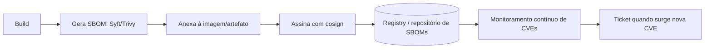

# SBOM - CycloneDX e SPDX

## Resumo

Um **SBOM** (Software Bill of Materials) é o inventário formal dos componentes de um software: bibliotecas, versões, licenças e relações de dependência. Funciona como a "lista de ingredientes" da aplicação. Quando surge uma vulnerabilidade de grande impacto, o SBOM responde rapidamente à pergunta "onde usamos esse componente?". Dois formatos dominam: **CycloneDX** (OWASP, orientado a segurança) e **SPDX** (Linux Foundation, ISO/IEC 5962, forte em licenciamento e conformidade). Governos e clientes corporativos passaram a exigir SBOMs de fornecedores.

## Conceitos-chave

- **Componente:** nome, versão, `purl` (Package URL), hashes, licença, fornecedor.
- **Dependências diretas e transitivas:** o grafo completo importa.
- **CycloneDX:** JSON/XML com `bomFormat`, `specVersion`, `components[]`, `dependencies[]`; suporta VEX.
- **SPDX:** documentos com pacotes, arquivos e relacionamentos; versões em JSON, tag-value e outros.
- **VEX (Vulnerability Exploitability eXchange):** declara se uma vulnerabilidade é realmente explorável no produto.
- **Geradores:** Syft, Trivy, cdxgen, ferramentas nativas de ecossistemas.
- **Momento da geração:** fonte, build ou imagem final.

## Como funciona



O ganho real vem do **monitoramento contínuo**: com o SBOM guardado, novos CVEs publicados depois do release geram alertas sem rebuild. Plataformas como o Dependency-Track ingerem SBOMs CycloneDX e correlacionam com bases de vulnerabilidades.

## Exemplo prático

Gerando e inspecionando um SBOM CycloneDX:

```bash
trivy image --format cyclonedx --output sbom.cdx.json minha-imagem:1.0
# ou, com Syft:
syft minha-imagem:1.0 -o cyclonedx-json=sbom.cdx.json
```

Listando componentes com licença em Python:

```python
import json

with open("sbom.cdx.json", encoding="utf-8") as f:
    bom = json.load(f)

print("Formato:", bom.get("bomFormat"), bom.get("specVersion"))
for c in bom.get("components", []):
    licencas = [l.get("license", {}).get("id", "?") for l in c.get("licenses", [])]
    print(c.get("name"), c.get("version"), c.get("purl"), licencas)
```

> [!example] Pergunta de negócio
> "Quais serviços usam `log4j-core` < 2.17?" vira uma busca por `purl` no repositório de SBOMs.

## Boas práticas

- Gere SBOM em todo release e guarde-o junto ao artefato versionado.
- Prefira gerar da **imagem final**, que reflete o que realmente roda.
- Assine o SBOM e verifique-o no consumo.
- Combine com VEX para reduzir falsos positivos.

## Erros comuns

- Gerar o SBOM e nunca consumi-lo.
- Ignorar dependências transitivas ou do sistema operacional.
- SBOM desatualizado em relação ao que está em produção.
- Confundir SBOM com lista de vulnerabilidades: ele é inventário.

> [!tip] Regra prática
> Se não consegue buscar um componente por `purl` em segundos, o SBOM ainda não está operacional.

## Referências para aprofundar

- CycloneDX (cyclonedx.org), SPDX (spdx.dev), NTIA *Minimum Elements for an SBOM*, OWASP Dependency-Track.

## Veja também

- [[SLSA]]
- [[Assinatura de Artefatos - Sigstore e cosign]]
- [[Ferramentas de Teste de Aplicação - SAST DAST IAST SCA]]
- [[IaC Scanning - Checkov e tfsec]]
- [[MOC - DevSecOps e CI-CD]]

#seguranca/devsecops/sbom #seguranca/supply-chain
