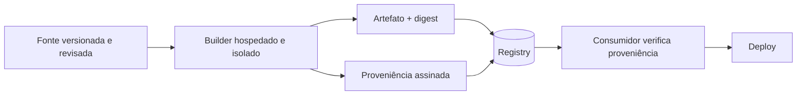

# SLSA

## Resumo

**SLSA** (pronuncia-se "salsa", *Supply-chain Levels for Software Artifacts*) é um framework do OpenSSF que define níveis crescentes de garantia sobre **como um artefato foi construído**. Ele responde: este binário veio realmente do código-fonte que alegam, por um processo de build confiável, sem adulteração no caminho? A especificação v1.0 foca no **trilho de build** (Build Track), com níveis de L1 a L3, baseados em **proveniência** (um registro assinado do que foi construído, por quem e a partir de quê).

## Conceitos-chave

- **Proveniência:** attestation que descreve fonte, builder, parâmetros e saída (digest).
- **Build L1:** proveniência existe (pode ser falsificável).
- **Build L2:** proveniência gerada e assinada por plataforma de build hospedada.
- **Build L3:** build endurecido, com isolamento entre execuções e chaves de assinatura inacessíveis aos passos do usuário.
- **Builds hermético e reproduzível:** propriedades adicionais desejáveis.
- **Verificação pelo consumidor:** de nada adianta gerar proveniência que ninguém checa.
- **Ameaças cobertas:** fonte adulterada, build comprometido, dependência trocada, publicação indevida.

## Como funciona



Na prática, no GitHub, workflows reutilizáveis do projeto `slsa-github-generator` ou *attestations* nativas geram proveniência assinada. A política de deploy exige que a proveniência aponte para o repositório e o workflow esperados.

## Exemplo prático

Trecho de proveniência (simplificado) e verificação conceitual:

```json
{
  "_type": "https://in-toto.io/Statement/v1",
  "subject": [{"name": "app", "digest": {"sha256": "ABC123"}}],
  "predicateType": "https://slsa.dev/provenance/v1",
  "predicate": {
    "buildDefinition": {
      "buildType": "https://actions.github.io/buildtypes/workflow/v1",
      "externalParameters": {"workflow": {"repository": "https://github.com/minha-org/app"}}
    },
    "runDetails": {"builder": {"id": "https://github.com/actions/runner"}}
  }
}
```

Verificação em Python (lógica de política):

```python
def proveniencia_ok(stmt: dict, repo_esperado: str) -> bool:
    repo = (stmt["predicate"]["buildDefinition"]
            ["externalParameters"]["workflow"]["repository"])
    return repo == repo_esperado       # a assinatura deve ser verificada antes
```

> [!example] Meta realista
> Para muitas equipes, alcançar Build L2 já é um grande avanço sobre o estado atual.

## Boas práticas

- Comece pelo L1/L2 e avance conforme o risco.
- Proteja a branch principal (revisão obrigatória, commits assinados).
- Verifique proveniência no deploy, com política de admissão.
- Combine SLSA com [[SBOM - CycloneDX e SPDX]] e assinatura.

## Erros comuns

- Gerar proveniência sem nunca verificá-la.
- Builders compartilhados onde um job pode alterar o outro.
- Dependências sem pinagem por hash.
- Achar que SLSA garante ausência de vulnerabilidades (ele garante a **origem e a integridade** do build).

> [!tip] Foco
> SLSA trata de integridade da cadeia, não de bugs no código.

## Referências para aprofundar

- slsa.dev (especificação v1.0); in-toto; OpenSSF Scorecard.

## Veja também

- [[Assinatura de Artefatos - Sigstore e cosign]]
- [[SBOM - CycloneDX e SPDX]]
- [[Security Gates e Shift-Left]]
- [[GitHub Actions]]
- [[MOC - DevSecOps e CI-CD]]

#seguranca/devsecops/slsa #seguranca/supply-chain
