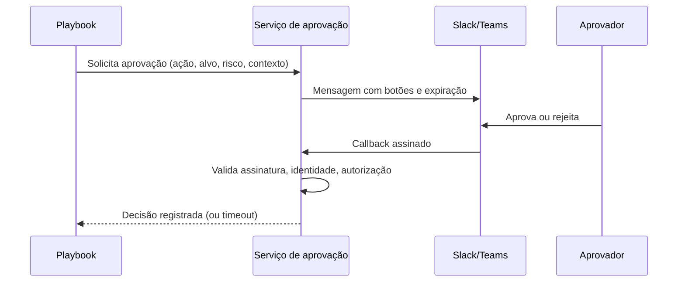

# Human-in-the-Loop

## Resumo

**Human-in-the-loop** (HITL) significa manter uma pessoa no circuito de decisão de ações automatizadas relevantes. Em segurança, nem tudo deve ser totalmente autônomo: uma contenção equivocada pode parar um sistema de produção, e decisões com impacto legal ou reputacional exigem julgamento humano. O desenho de HITL define **quais ações exigem aprovação**, **quem pode aprovar**, **como a aprovação é solicitada e registrada** e o que acontece se ninguém responde. É um equilíbrio entre velocidade e segurança, e também um controle de separação de funções.

## Conceitos-chave

- **Níveis de autonomia:** *sugere*, *executa com aprovação*, *executa e notifica*, *autônomo*.
- **Matriz de risco:** impacto × reversibilidade determina o nível.
- **Canal de aprovação:** botões em Slack/Teams, tela do SOAR, ticket.
- **Autenticação do aprovador:** identidade verificada, assinatura da requisição e autorização.
- **Timeout:** ação cancelada, escalada ou executada em modo seguro se ninguém responde.
- **Trilha de auditoria:** quem aprovou, quando, com qual contexto.
- **Dupla aprovação** (*four-eyes*) para ações críticas.

## Como funciona



A decisão volta ao playbook, que prossegue ou desvia. No *timeout*, a política padrão deve ser **não executar** ações destrutivas e escalar a um segundo aprovador.

## Exemplo prático

Serviço de aprovação mínimo com expiração e autorização (Python):

```python
import secrets, time

PENDENTES: dict[str, dict] = {}
APROVADORES = {"ana@empresa.com", "joao@empresa.com"}

def solicitar(acao: str, alvo: str, ttl: int = 900) -> str:
    id_ = secrets.token_urlsafe(16)               # id imprevisível
    PENDENTES[id_] = {"acao": acao, "alvo": alvo, "expira": time.time() + ttl}
    return id_

def decidir(id_: str, usuario: str, aprovar: bool) -> str:
    p = PENDENTES.pop(id_, None)                   # consome: evita reuso
    if not p or time.time() > p["expira"]:
        return "expirado"
    if usuario not in APROVADORES:
        return "negado: usuario sem permissao"
    return "aprovado" if aprovar else "rejeitado"
```

> [!warning] Produção
> Em produção, a identidade do usuário vem de um callback assinado (veja [[Integração com Mensageria - Slack e Teams]]), nunca de um parâmetro livre.

## Boas práticas

- Classifique ações por risco e defina o nível de autonomia de cada uma.
- Apresente ao aprovador contexto suficiente (evidências, impacto estimado).
- Use expiração e registre todas as decisões.
- Revise periodicamente quais aprovações podem virar automáticas com segurança.

## Erros comuns

- Aprovação por link sem autenticação.
- *Alert fatigue* em aprovações: aprovar tudo por reflexo.
- Sem timeout, deixando ações pendentes indefinidamente.
- Mesmo usuário solicita e aprova (sem separação de funções).

> [!tip] Métrica
> Acompanhe taxa de aprovação e tempo de resposta; 100% de aprovação indica que a etapa talvez seja desnecessária.

## Referências para aprofundar

- Publicações do NIST sobre automação e IA em segurança; ISO/IEC 27001 (separação de funções).

## Veja também

- [[Automação de Resposta a Incidentes]]
- [[Playbooks e Runbooks]]
- [[Integração com Mensageria - Slack e Teams]]
- [[Enriquecimento de Alertas e Escalonamento]]
- [[MOC - Automação e Orquestração]]

#seguranca/automacao/hitl #seguranca/governanca/automacao
