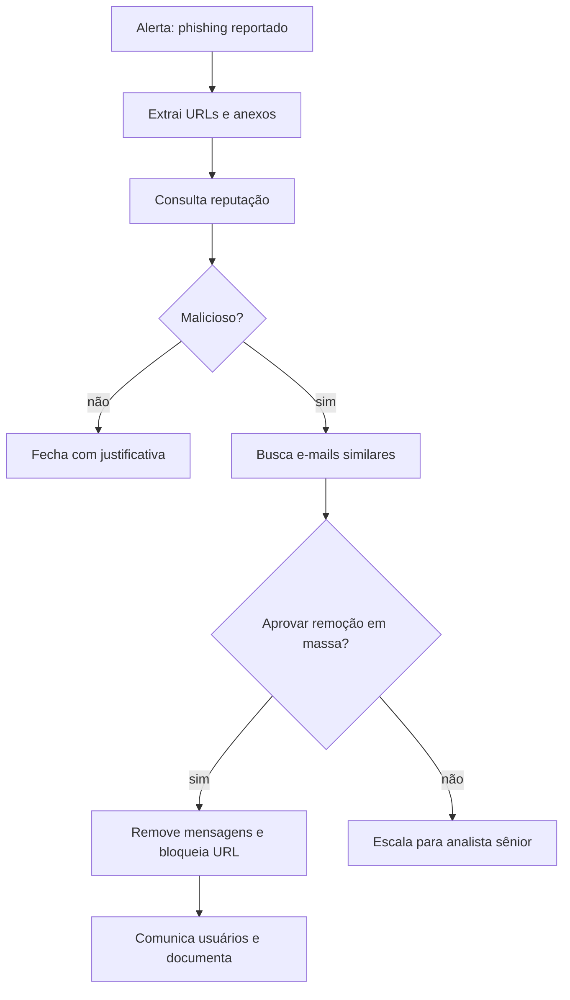

# Playbooks e Runbooks

## Resumo

Um **runbook** é um procedimento operacional documentado para uma tarefa recorrente; um **playbook** de segurança é um runbook orientado a um cenário (phishing reportado, malware em endpoint, credencial vazada) que descreve gatilho, decisões e ações. Escrever playbooks força a equipe a explicitar o que hoje está "na cabeça" dos analistas, torna a resposta consistente e cria a base para automação. O caminho recomendado é: documentar, executar manualmente, medir, e só então automatizar os passos estáveis, mantendo humanos nas decisões de risco.

## Conceitos-chave

- **Gatilho:** alerta, e-mail, ticket ou chamada manual.
- **Entradas:** artefatos (URL, hash, usuário, host) e contexto.
- **Passos:** coleta, enriquecimento, decisão, contenção, comunicação, encerramento.
- **Pontos de decisão:** condições com critérios claros (reputação, criticidade do ativo).
- **Ações reversíveis vs. irreversíveis:** as últimas exigem aprovação.
- **Saídas e evidências:** registro de tudo que foi feito para auditoria.
- **Versão e dono:** playbooks são versionados e revisados.

## Como funciona



A representação em código (YAML) de um playbook permite versionar, revisar por pares e testar. Cada passo declara a ação, os parâmetros e se requer aprovação.

## Exemplo prático

Playbook declarativo em YAML e um executor mínimo (Python):

```yaml
nome: phishing-reportado
gatilho: email_reportado
passos:
  - id: extrair
    acao: extrair_iocs
  - id: reputacao
    acao: consultar_reputacao
    entrada: "{{ extrair.iocs }}"
  - id: decisao
    se: "reputacao.malicioso >= 3"
    entao:
      - acao: remover_emails
        requer_aprovacao: true
    senao:
      - acao: fechar_caso
```

```python
def executar(playbook: dict, contexto: dict, acoes: dict, aprovar):
    for passo in playbook["passos"]:
        acao = passo["acao"]
        if passo.get("requer_aprovacao") and not aprovar(passo, contexto):
            contexto.setdefault("log", []).append(f"{acao}: não aprovado")
            continue                              # registra e segue/encerra conforme a política
        contexto[passo["id"]] = acoes[acao](contexto)   # executa a ação registrada
        contexto.setdefault("log", []).append(f"{acao}: ok")
    return contexto
```

> [!example] Registro
> O campo `log` vira a trilha de auditoria anexada ao caso.

## Boas práticas

- Comece por cenários frequentes e de baixo risco.
- Defina critérios objetivos de decisão e de escalonamento.
- Teste playbooks em laboratório com dados sintéticos.
- Revise após cada incidente real (lições aprendidas).

## Erros comuns

- Automatizar um processo que ninguém entende.
- Playbooks desatualizados que apontam para ferramentas desativadas.
- Ações destrutivas sem aprovação nem reversão.
- Sem registro do que foi executado.

> [!warning] Reversibilidade
> Pergunte, para cada ação: se estiver errada, conseguimos desfazer?

## Referências para aprofundar

- NIST SP 800-61 (Resposta a Incidentes); PagerDuty Incident Response docs; Atomic Red Team para testes (em laboratório).

## Veja também

- [[SOAR - Shuffle TheHive Cortex e n8n]]
- [[Automação de Resposta a Incidentes]]
- [[Human-in-the-Loop]]
- [[Enriquecimento de Alertas e Escalonamento]]
- [[MOC - Automação e Orquestração]]

#seguranca/automacao/playbooks #seguranca/resposta-incidentes
