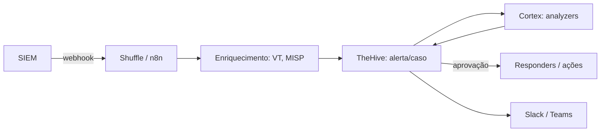

# SOAR - Shuffle TheHive Cortex e n8n

## Resumo

Plataformas **SOAR** reúnem orquestração, automação e gestão de casos. Três opções open source/fair-code relevantes: **Shuffle** (SOAR open source com editor visual, *apps* baseados em OpenAPI e gatilhos por webhook), **TheHive + Cortex** (TheHive gerencia alertas e casos; Cortex executa *analyzers* de enriquecimento e *responders* de ação) e **n8n** (automação de workflows de propósito geral, com nó de webhook e muitas integrações). Cada uma resolve parte do problema; muitas equipes combinam: SIEM → Shuffle/n8n → TheHive/Cortex.

## Conceitos-chave

- **Shuffle:** workflows com gatilhos (webhook, agendamento), apps, condições e aprovação manual por usuário.
- **TheHive:** alertas, casos, tarefas, observáveis (IoCs), integração com MISP; verifique a **versão e licença** vigentes (a linha 5 mudou o modelo de licenciamento).
- **Cortex:** analyzers (reputação, sandbox, WHOIS) e responders (bloquear, notificar), executados via API.
- **n8n:** editor visual, nó *Webhook*, nó *HTTP Request*, código customizado; verifique os termos de licença para seu uso.
- **Observáveis e casos:** modelo de dados central.
- **Conectores customizados:** via API REST/OpenAPI.

## Como funciona



O SIEM envia o alerta por webhook; o orquestrador extrai observáveis, consulta fontes e cria um alerta/caso no TheHive. Analistas decidem, e as ações aprovadas executam por responders ou chamadas de API. Todo o fluxo gera trilha de auditoria.

## Exemplo prático

Criando um alerta no TheHive via API REST (formato da API v1; confirme na documentação da sua versão):

```python
import os, requests

def criar_alerta(titulo: str, descricao: str, severidade: int, ref: str):
    corpo = {
        "type": "siem",
        "source": "meu-conector",
        "sourceRef": ref,                 # referência única, útil para evitar duplicatas
        "title": titulo,
        "description": descricao,
        "severity": severidade,           # 1 baixa ... 4 crítica
        "tags": ["automatizado"],
    }
    r = requests.post(
        "https://thehive.local:9000/api/v1/alert",
        json=corpo,
        headers={"Authorization": f"Bearer {os.environ['THEHIVE_API_KEY']}"},
        timeout=15)
    r.raise_for_status()
    return r.json()
```

Gatilho de webhook em um workflow (conceito, vale para Shuffle e n8n):

```bash
curl -X POST "https://orquestrador.local/webhook/alerta-siem" -H "Content-Type: application/json" -H "X-Signature: <hmac>" -d '{"regra":"brute-force","ip":"203.0.113.7"}'
```

> [!tip] Referência única
> Use `sourceRef` estável para que o mesmo alerta reenviado não crie casos duplicados.

## Boas práticas

- Valide a autenticidade dos webhooks que disparam workflows.
- Use contas de serviço com permissões mínimas em cada app.
- Versione os workflows (exporte para git) e promova entre ambientes.
- Monitore falhas de execução e filas pendentes.

## Erros comuns

- Webhook de gatilho aberto sem autenticação.
- Credenciais salvas em texto nos nós do workflow.
- Um workflow gigante e impossível de testar; prefira sub-workflows.
- Ignorar limites de taxa das integrações.
- Adotar uma plataforma sem verificar licença e suporte.

> [!warning] Segurança do orquestrador
> O SOAR concentra credenciais de muitas ferramentas; é um alvo de alto valor. Isole, proteja e audite.

## Referências para aprofundar

- Docs do Shuffle, TheHive/Cortex (StrangeBee) e n8n.

## Veja também

- [[Playbooks e Runbooks]]
- [[Ferramentas de Detecção e Resposta - EDR SIEM SOAR]]
- [[Enriquecimento de Alertas e Escalonamento]]
- [[Integração com Threat Intelligence - MISP OpenCTI e VirusTotal]]
- [[MOC - Automação e Orquestração]]

#seguranca/automacao/soar #seguranca/automacao/shuffle #seguranca/automacao/thehive
