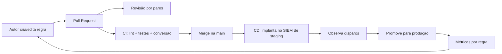

# Detecção como Código

## Resumo

**Detecção como código** (Detection as Code) aplica práticas de engenharia de software ao ciclo de vida das regras de detecção: elas ficam em repositório git, passam por revisão (PR), validação automática, testes e implantação por pipeline. Em vez de editar regras diretamente na interface do SIEM (sem histórico, sem revisão, sem testes), o time trata cada regra como artefato versionado. O resultado é rastreabilidade, reprodutibilidade, menos regressões e capacidade de mover regras entre ambientes e plataformas.

## Conceitos-chave

- **Repositório de regras:** Sigma, YARA, Suricata, consultas nativas, com metadados padronizados.
- **Revisão por pares:** PR com checklist (objetivo, ATT&CK, falsos positivos, testes).
- **CI:** lint, validação de esquema, testes com eventos de amostra, conversão para o SIEM.
- **CD:** implantação por API (ambientes: dev → staging → produção) com *rollback* via git.
- **Metadados:** `id`, `owner`, `status`, `severidade`, `data_revisao`, `tecnicas`.
- **Ciclo de vida:** experimental → teste → estável → obsoleta.
- **Observabilidade das regras:** taxa de disparo e de falsos positivos por regra.

## Como funciona



O pipeline impede que uma regra sem testes ou sem metadados chegue à produção. A implantação por API (com credencial de serviço de menor privilégio) torna a ação auditável.

## Exemplo prático

Validador de metadados executado no CI (Python):

```python
import sys, uuid, pathlib
import yaml   # pip install pyyaml

OBRIGATORIOS = {"title", "id", "status", "logsource", "detection", "level", "tags"}
STATUS_VALIDOS = {"experimental", "test", "stable", "deprecated"}

def validar(caminho: pathlib.Path, ids_vistos: set) -> list[str]:
    erros = []
    regra = yaml.safe_load(caminho.read_text(encoding="utf-8"))   # safe_load!
    faltando = OBRIGATORIOS - set(regra)
    if faltando:
        erros.append(f"{caminho}: campos ausentes {sorted(faltando)}")
    try:
        uuid.UUID(str(regra.get("id")))
    except ValueError:
        erros.append(f"{caminho}: id não é UUID")
    if regra.get("id") in ids_vistos:
        erros.append(f"{caminho}: id duplicado")
    ids_vistos.add(regra.get("id"))
    if regra.get("status") not in STATUS_VALIDOS:
        erros.append(f"{caminho}: status inválido")
    return erros

if __name__ == "__main__":
    vistos, todos = set(), []
    for p in pathlib.Path("regras").rglob("*.yml"):
        todos += validar(p, vistos)
    print("\n".join(todos))
    sys.exit(1 if todos else 0)
```

Workflow resumido:

```yaml
name: deteccao-ci
on: [pull_request]
permissions: {contents: read}
jobs:
  validar:
    runs-on: ubuntu-latest
    steps:
      - uses: actions/checkout@v4
      - run: pip install pyyaml sigma-cli pytest
      - run: python ferramentas/validar_regras.py
      - run: sigma check regras/
      - run: pytest tests/
```

## Boas práticas

- Exija testes para toda regra nova.
- Promova por ambientes e observe antes de alertar o plantão.
- Registre dono e data de revisão; aposente regras obsoletas.
- Proteja a branch principal e as credenciais de implantação no SIEM.

## Erros comuns

- Editar regras direto no SIEM, criando divergência com o repositório.
- Regras sem dono.
- Pipeline de implantação com credencial administrativa ampla.
- Medir quantidade de regras em vez de eficácia.

> [!tip] Indicador
> Acompanhe, por regra, quantos alertas viraram incidentes reais. Regras que nunca resultam em ação merecem revisão.

## Referências para aprofundar

- *Detection Engineering* (SANS, Elastic *Detection Rules*); repositório SigmaHQ.

## Veja também

- [[Regras Sigma]]
- [[Testes de Regras de Detecção]]
- [[Security Gates e Shift-Left]]
- [[Políticas como Código - OPA e Rego]]
- [[MOC - Observabilidade e Detecção]]

#seguranca/deteccao/detection-as-code #seguranca/devsecops/policy-as-code
