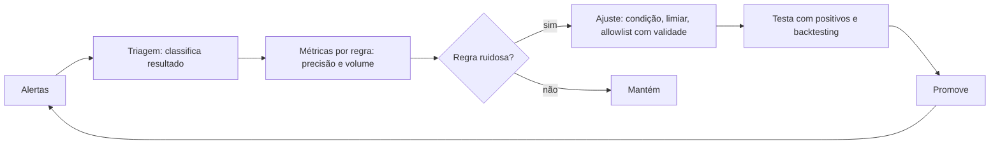

# Redução de Falsos Positivos

## Resumo

**Falsos positivos** são alertas disparados por atividade legítima. Em excesso, causam *alert fatigue*: analistas passam a ignorar alertas, e os verdadeiros se perdem no ruído. Reduzi-los **sem criar pontos cegos** é uma disciplina contínua chamada *tuning*. Envolve tornar as regras mais precisas, usar contexto (criticidade do ativo, comportamento habitual, reputação), aplicar limiares e janelas, suprimir duplicatas e medir a precisão de cada regra. O objetivo não é zero alertas, e sim que cada alerta mereça atenção.

## Conceitos-chave

- **Precisão:** verdadeiros positivos ÷ (verdadeiros + falsos positivos).
- **Técnicas de redução:** refinar condições, *allowlist* com validade, *baseline* de comportamento, limiares e janelas de tempo, enriquecimento contextual, agrupamento e deduplicação.
- **Supressão vs. allowlist:** suprimir esconde o alerta; allowlist específica remove a causa conhecida. Ambas exigem dono e expiração.
- **Severidade dinâmica:** a mesma regra pode ter prioridades diferentes por ativo.
- **Ciclo de feedback:** analistas classificam alertas (verdadeiro, falso, benigno) e a classificação alimenta o ajuste.
- **Risco do excesso de tuning:** exclusões amplas viram brechas para um adversário.

## Como funciona



O ciclo exige que a classificação das decisões dos analistas seja registrada de forma estruturada. Sem esses dados, o ajuste é opinião; com eles, vira engenharia.

## Exemplo prático

Allowlist com expiração e deduplicação por janela (Python):

```python
import time
from datetime import date

ALLOWLIST = [
    # (regra_id, campo, valor, expira_em, justificativa)
    ("3f1c2b6e-...", "host", "srv-automacao-01", "2026-12-31",
     "Script legítimo de gerenciamento, aprovado no CHG-4321"),
]
_ultimo: dict[tuple, float] = {}
JANELA = 600  # 10 minutos

def deve_alertar(alerta: dict) -> bool:
    for regra_id, campo, valor, expira, _ in ALLOWLIST:
        if (alerta["regra_id"] == regra_id
                and alerta.get(campo) == valor
                and date.fromisoformat(expira) >= date.today()):
            return False                        # exceção ainda válida
    chave = (alerta["regra_id"], alerta.get("host"))
    agora = time.time()
    if agora - _ultimo.get(chave, 0) < JANELA:
        return False                            # duplicado na janela
    _ultimo[chave] = agora
    return True
```

> [!example] Dados do ajuste
> Registrar `justificativa` e `expira` evita que exceções temporárias virem permanentes sem revisão.

## Boas práticas

- Ajuste com base em dados (precisão por regra), não em impressões.
- Prefira exclusões específicas (host + processo + usuário) a amplas.
- Toda exceção tem dono, motivo e prazo.
- Faça amostragem dos alertas suprimidos para detectar erros.

## Erros comuns

- Desativar a regra barulhenta em vez de refiná-la.
- Allowlists genéricas ("ignorar toda a rede interna").
- Nunca revisar exceções antigas.
- Medir apenas o volume de alertas, e não a taxa de verdadeiros positivos.

> [!warning] Equilíbrio
> Cada exclusão tem custo: pergunte como um adversário poderia se esconder dentro dela.

## Referências para aprofundar

- Capítulos sobre tuning em guias de SOC e engenharia de detecção; FIRST CSIRT Services Framework.

## Veja também

- [[Regras Sigma]]
- [[Enriquecimento de Alertas e Escalonamento]]
- [[Testes de Regras de Detecção]]
- [[Detecção como Código]]
- [[MOC - Observabilidade e Detecção]]

#seguranca/deteccao/falsos-positivos #seguranca/operacoes/tuning
