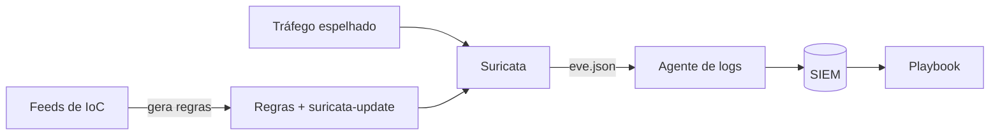

# Suricata - Integração

## Resumo

**Suricata** é um motor open source de detecção de intrusão em rede (IDS), prevenção (IPS) e monitoramento de segurança de rede (NSM). Ele inspeciona pacotes e fluxos, decodifica protocolos (HTTP, DNS, TLS, SMB), aplica **regras** com sintaxe compatível com a família Snort e gera registros estruturados em **`eve.json`**: alertas, metadados de protocolo, fluxos e estatísticas. Para o integrador, o `eve.json` é uma fonte rica de eventos que alimenta o SIEM e o SOAR; o motor de regras é o ponto de aplicação de indicadores de threat intelligence na rede.

## Conceitos-chave

- **Modos:** IDS (passivo, via espelhamento/TAP) e IPS (inline, bloqueia).
- **Anatomia da regra:** *ação* (`alert`, `drop`), *cabeçalho* (protocolo, origem, destino) e *opções* (`msg`, `content`, `flow`, `sid`, `rev`, `classtype`).
- **Buffers sticky:** `http.host`, `dns.query`, `tls.sni` permitem casar campos específicos.
- **`sid`:** identificador único; use faixa local (≥ 1000000) para regras próprias.
- **`eve.json`:** saída JSON com `event_type` (`alert`, `dns`, `http`, `tls`, `flow`).
- **Atualização de regras:** `suricata-update` gerencia fontes (ex.: ET Open).
- **Desempenho:** afinação de threads, rulesets e hardware.

## Como funciona



Um conector pode transformar IoCs (domínios, IPs) de uma plataforma de threat intelligence em regras Suricata, publicar o arquivo `.rules` em um repositório e acionar a atualização controlada nos sensores, sempre com validação sintática antes da implantação.

## Exemplo prático

Regra Suricata de laboratório (alerta para consulta HTTP a um domínio de teste):

```text
alert http $HOME_NET any -> $EXTERNAL_NET any (msg:"LAB - Acesso a dominio de teste de IoC"; flow:established,to_server; http.host; content:"ioc-teste.example.com"; nocase; classtype:policy-violation; sid:1000001; rev:1;)
```

Validação e teste offline com um PCAP de laboratório:

```bash
suricata -T -c /etc/suricata/suricata.yaml -S regras/local.rules
suricata -r captura-lab.pcap -S regras/local.rules -l /tmp/saida
```

Lendo alertas do `eve.json` (Python):

```python
import json

def alertas(caminho: str):
    with open(caminho, encoding="utf-8") as f:
        for linha in f:                       # um JSON por linha
            ev = json.loads(linha)
            if ev.get("event_type") == "alert":
                yield {
                    "assinatura": ev["alert"]["signature"],
                    "severidade": ev["alert"]["severity"],
                    "origem": ev.get("src_ip"),
                    "destino": ev.get("dest_ip"),
                }
```

## Boas práticas

- Valide a sintaxe das regras (`-T`) antes de implantar.
- Teste regras com PCAPs de laboratório e meça o impacto no desempenho.
- Gerencie `sid` e `rev` e mantenha as regras locais em git.
- Enriqueça os alertas com contexto do ativo antes de notificar.

## Erros comuns

- Ativar todos os rulesets públicos sem ajuste (ruído e custo).
- Reutilizar `sid` entre regras.
- Sensor sem capacidade para o volume, descartando pacotes silenciosamente.
- Inspecionar tráfego TLS sem considerar a limitação de visibilidade (SNI/JA3 são alternativas de metadados).

> [!question] Visibilidade
> Quais segmentos de rede críticos ainda não têm sensor?

## Referências para aprofundar

- docs.suricata.io; Emerging Threats Open; guia de `suricata-update`.

## Veja também

- [[Regras Sigma]]
- [[YARA - Integração]]
- [[Ferramentas de Detecção e Resposta - EDR SIEM SOAR]]
- [[Integração com Threat Intelligence - MISP OpenCTI e VirusTotal]]
- [[MOC - Observabilidade e Detecção]]

#seguranca/deteccao/suricata #seguranca/deteccao/rede
