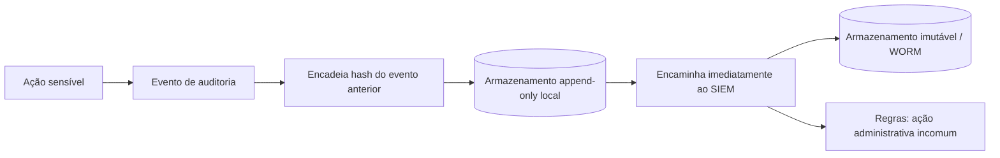

# Auditoria e Logs de Ações

## Resumo

A **auditoria** responde a quatro perguntas sobre qualquer ação relevante: *quem* fez, *o quê*, *quando* e *com qual resultado*, além de *de onde* e *por quê*. Em ferramentas de segurança, que podem isolar hosts, bloquear contas e abrir incidentes, a trilha de auditoria é essencial para investigação, prestação de contas, conformidade e para detectar abuso da própria ferramenta (por exemplo, um operador executando ações fora do padrão). Diferente do log técnico de depuração, o log de auditoria deve ser **completo para as ações sensíveis, íntegro, protegido contra alteração e retido** pelo prazo definido.

## Conceitos-chave

- **Eventos a registrar:** login e falhas, mudanças de permissão, execução de ações de resposta, aprovações, alterações de configuração e de regras, acesso a dados sensíveis, exportações.
- **Campos:** `timestamp` UTC, `ator` (usuário/serviço), `acao`, `alvo`, `resultado`, `origem` (IP/sessão), `correlation_id`, `motivo`.
- **Integridade:** armazenamento *append-only*, encadeamento por hash (*hash chain*), assinatura e envio imediato a um destino que o operador não controla.
- **Separação:** quem administra a ferramenta não deve poder apagar sua auditoria.
- **Sincronização de tempo (NTP)** para correlacionar eventos.
- **Retenção e acesso:** prazos definidos e acesso restrito; alinhar com [[LGPD e Privacidade]].
- **Monitoramento:** alertas sobre ações administrativas incomuns.

## Como funciona



O encadeamento por hash dá *evidência de adulteração*: se alguém alterar ou remover um registro, os hashes seguintes deixam de bater. O envio imediato a um sistema externo protege a trilha mesmo que o host seja comprometido.

## Exemplo prático

Log de auditoria com encadeamento por hash (Python):

```python
import hashlib, json
from datetime import datetime, timezone

class Auditoria:
    def __init__(self, caminho: str):
        self.caminho = caminho
        self.ultimo = self._ultimo_hash()

    def _ultimo_hash(self) -> str:
        try:
            with open(self.caminho, encoding="utf-8") as f:
                linhas = f.read().strip().splitlines()
            return json.loads(linhas[-1])["hash"] if linhas else "0" * 64
        except FileNotFoundError:
            return "0" * 64

    def registrar(self, ator: str, acao: str, alvo: str, resultado: str, motivo: str = ""):
        evento = {
            "ts": datetime.now(timezone.utc).isoformat(),
            "ator": ator, "acao": acao, "alvo": alvo,
            "resultado": resultado, "motivo": motivo,
            "hash_anterior": self.ultimo,
        }
        corpo = json.dumps(evento, sort_keys=True, ensure_ascii=False)
        evento["hash"] = hashlib.sha256(corpo.encode()).hexdigest()
        with open(self.caminho, "a", encoding="utf-8") as f:   # somente anexa
            f.write(json.dumps(evento, ensure_ascii=False) + "\n")
        self.ultimo = evento["hash"]

def verificar(caminho: str) -> bool:
    anterior = "0" * 64
    with open(caminho, encoding="utf-8") as f:
        for linha in f:
            ev = json.loads(linha)
            h = ev.pop("hash")
            if ev["hash_anterior"] != anterior:
                return False
            corpo = json.dumps(ev, sort_keys=True, ensure_ascii=False)
            if hashlib.sha256(corpo.encode()).hexdigest() != h:
                return False
            anterior = h
    return True
```

> [!example] Uso
> `auditoria.registrar("ana", "isolar_host", "srv-12", "sucesso", "CASO-889")`.

## Boas práticas

- Defina previamente o catálogo de eventos auditáveis.
- Registre **tentativas negadas** também, não só sucessos.
- Exporte a trilha para armazenamento fora do alcance dos administradores da ferramenta.
- Revise periodicamente quem acessa a auditoria e use-a ativamente (alertas, revisões).

## Erros comuns

- Misturar auditoria com logs de depuração e perder eventos no ruído.
- Permitir que administradores apaguem ou editem registros.
- Registrar dados pessoais ou segredos em excesso.
- Ter a trilha, mas nunca consultá-la.

> [!question] Responsabilização
> Se uma ação destrutiva ocorreu ontem às 3h, você consegue dizer, com evidências íntegras, quem a executou e por quê?

## Referências para aprofundar

- OWASP Logging Cheat Sheet; NIST SP 800-92 (Gerenciamento de logs); ISO/IEC 27001 (registro e monitoramento).

## Veja também

- [[Logging Estruturado]]
- [[Human-in-the-Loop]]
- [[LGPD e Privacidade]]
- [[Integração com SIEM - Splunk Elastic e Wazuh]]
- [[MOC - Segurança da Própria Ferramenta]]

#seguranca/ferramenta/auditoria #seguranca/governanca/logs
