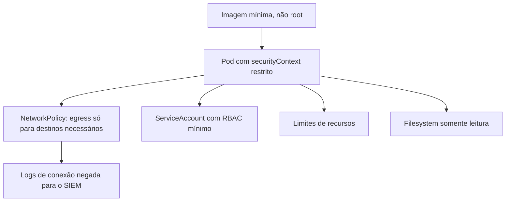

# Privilégio Mínimo e Hardening de Containers

## Resumo

Mesmo código bem escrito pode ser comprometido; **hardening** limita o estrago. O princípio do **menor privilégio** aplicado à execução da ferramenta significa que o processo roda com a menor identidade e as menores capacidades possíveis: usuário não root, sistema de arquivos somente leitura, sem capacidades do kernel desnecessárias, rede restrita ao que precisa, permissões mínimas na plataforma (Kubernetes RBAC, IAM). Assim, uma falha de aplicação (por exemplo, uma execução de comando indevida) encontra um ambiente onde há pouco a explorar e pouco para onde se mover.

## Conceitos-chave

- **Usuário não root** e `no-new-privileges`.
- **Sistema de arquivos somente leitura** com volumes temporários explícitos.
- **Capabilities:** remover todas (`drop: ALL`) e adicionar só as necessárias.
- **Seccomp/AppArmor/SELinux:** perfis que restringem chamadas de sistema.
- **Imagens mínimas** (distroless), sem shell nem gerenciador de pacotes.
- **Rede:** `NetworkPolicy` com *deny by default* e egress restrito (também reduz risco de SSRF).
- **ServiceAccount mínima** e `automountServiceAccountToken: false` quando não necessário.
- **Limites de recursos** (CPU, memória) contra negação de serviço.
- **Benchmarks:** CIS Docker/Kubernetes; Pod Security Standards (*restricted*).

## Como funciona



Cada camada é independente. Se um invasor executa código dentro do container, não consegue instalar ferramentas (sem gerenciador de pacotes), gravar em disco, escalar privilégios nem alcançar a rede interna além do permitido.

## Exemplo prático

Pod Kubernetes com configuração restrita:

```yaml
apiVersion: v1
kind: Pod
metadata:
  name: conector-jira
spec:
  automountServiceAccountToken: false
  securityContext:
    runAsNonRoot: true
    runAsUser: 10001
    seccompProfile: {type: RuntimeDefault}
  containers:
    - name: app
      image: registry.local/conector@sha256:ABC123...
      securityContext:
        allowPrivilegeEscalation: false
        readOnlyRootFilesystem: true
        capabilities: {drop: ["ALL"]}
      resources:
        limits: {cpu: "500m", memory: "256Mi"}
      volumeMounts:
        - {name: tmp, mountPath: /tmp}
  volumes:
    - {name: tmp, emptyDir: {}}
```

NetworkPolicy com egress limitado:

```yaml
apiVersion: networking.k8s.io/v1
kind: NetworkPolicy
metadata: {name: conector-egress}
spec:
  podSelector: {matchLabels: {app: conector}}
  policyTypes: [Egress]
  egress:
    - to:
        - ipBlock: {cidr: 203.0.113.0/24}   # faixa do serviço de destino (exemplo)
      ports: [{port: 443}]
```

## Boas práticas

- Aplique Pod Security *restricted* por padrão e justifique exceções.
- Use imagens fixadas por digest e escaneadas.
- Separe ambientes e contas; não compartilhe namespaces entre ferramentas com níveis de confiança diferentes.
- Monitore tentativas bloqueadas (negações de rede, violações de seccomp).

## Erros comuns

- Containers `privileged` ou com `hostPath`/`docker.sock` montado.
- ServiceAccount com `cluster-admin` "para facilitar".
- Sem limites de recursos.
- Deixar o egress totalmente aberto.

> [!warning] docker.sock
> Montar o socket do Docker equivale a dar controle total do host ao container.

## Referências para aprofundar

- CIS Kubernetes Benchmark; Kubernetes Pod Security Standards; NSA/CISA Kubernetes Hardening Guide.

## Veja também

- [[Gestão de Segredos na Ferramenta]]
- [[Empacotamento e Containers]]
- [[Supply Chain da Ferramenta]]
- [[Auditoria e Logs de Ações]]
- [[MOC - Segurança da Própria Ferramenta]]

#seguranca/ferramenta/hardening #seguranca/containers #seguranca/principios/menor-privilegio
