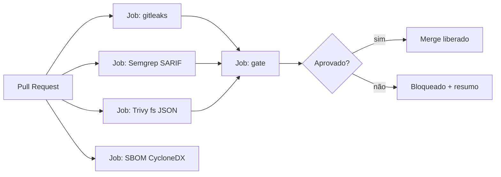

# Projeto 2 - Pipeline CI com Gates de Segurança

> [!warning] Laboratório
> Execute os exercícios apenas em ambiente isolado e autorizado, com dados sintéticos e credenciais de teste.

## Resumo

Você montará um workflow de **GitHub Actions** com verificações de segurança em paralelo (segredos, SAST, SCA, SBOM) e um **gate** final que consolida os resultados e decide se o merge pode acontecer. O projeto aplica privilégio mínimo ao `GITHUB_TOKEN`, publica SARIF e gera SBOM como artefato.

## Objetivo

Ter um pipeline que bloqueia PRs com segredos, achados SAST de severidade alta ou vulnerabilidades críticas com correção disponível, mantendo feedback em poucos minutos.

## Pré-requisitos

- Repositório no GitHub com um app de exemplo (Python ou Go).
- Leitura prévia: [[Security Gates e Shift-Left]], [[GitHub Actions]], [[SBOM - CycloneDX e SPDX]], [[Pré-commit Hooks]].
- Permissão para criar workflows e regras de proteção de branch.

## Conceitos-chave

- Jobs paralelos e dependência de um job `gate`.
- `permissions` mínimas por job.
- Artefatos (SARIF/JSON/SBOM) passados entre jobs.
- Script de gate com exit code.
- Proteção de branch com *status checks* obrigatórios.

## Como funciona



## Passo a passo

1. Crie `.github/workflows/seguranca.yml` e `scripts/gate.py`.
2. Fixe as actions por **SHA** (os `@vX` abaixo são só para leitura).
3. Em *Settings → Branches*, exija os checks `gitleaks`, `semgrep`, `trivy`, `gate`.
4. Abra um PR de teste com um segredo falso (por exemplo, a string `AKIAEXEMPLO...` de documentação) e verifique o bloqueio.
5. Corrija e verifique a aprovação.
6. Restrinja edição de `.github/workflows/` via CODEOWNERS.

## Exemplo prático

### Código de referência

```yaml
name: seguranca
on:
  pull_request:
permissions:
  contents: read

jobs:
  gitleaks:
    runs-on: ubuntu-latest
    steps:
      - uses: actions/checkout@v4
        with: {fetch-depth: 0}
      - uses: gitleaks/gitleaks-action@v2     # fixe por SHA
        env:
          GITHUB_TOKEN: ${{ secrets.GITHUB_TOKEN }}

  semgrep:
    runs-on: ubuntu-latest
    container: {image: semgrep/semgrep}       # fixe a versão/digest
    steps:
      - uses: actions/checkout@v4
      - run: semgrep scan --config p/ci --sarif --output semgrep.sarif
      - uses: actions/upload-artifact@v4
        with: {name: semgrep, path: semgrep.sarif}

  trivy:
    runs-on: ubuntu-latest
    steps:
      - uses: actions/checkout@v4
      - run: |
          curl -sfL https://raw.githubusercontent.com/aquasecurity/trivy/main/contrib/install.sh | sh -s -- -b /usr/local/bin
          trivy fs --format json --output trivy.json --severity HIGH,CRITICAL .
          trivy fs --format cyclonedx --output sbom.cdx.json .
      - uses: actions/upload-artifact@v4
        with:
          name: trivy
          path: |
            trivy.json
            sbom.cdx.json

  gate:
    needs: [gitleaks, semgrep, trivy]
    runs-on: ubuntu-latest
    steps:
      - uses: actions/checkout@v4
      - uses: actions/download-artifact@v4
      - run: python scripts/gate.py semgrep/semgrep.sarif trivy/trivy.json
```

```python
# scripts/gate.py
import json, sys

def semgrep_erros(caminho):
    with open(caminho, encoding="utf-8") as f:
        sarif = json.load(f)
    return [r for run in sarif.get("runs", []) for r in run.get("results", [])
            if r.get("level") == "error"]

def trivy_criticas_com_correcao(caminho):
    with open(caminho, encoding="utf-8") as f:
        dados = json.load(f)
    return [v for res in dados.get("Results", []) for v in (res.get("Vulnerabilities") or [])
            if v["Severity"] == "CRITICAL" and v.get("FixedVersion")]

if __name__ == "__main__":
    sarif, trivy = sys.argv[1], sys.argv[2]
    erros, criticas = semgrep_erros(sarif), trivy_criticas_com_correcao(trivy)
    print(f"Semgrep (error): {len(erros)} | Trivy (críticas c/ correção): {len(criticas)}")
    sys.exit(1 if erros or criticas else 0)
```

> [!warning] Piped installer
> O `curl | sh` acima é apenas ilustrativo; em produção, use a action oficial fixada por SHA ou uma imagem com versão e digest verificados.

## Critérios de conclusão

- O PR com segredo de teste falha no job `gitleaks` e o merge é bloqueado.
- O `gate` falha com achado SAST de nível `error` ou vulnerabilidade crítica corrigível.
- O SBOM fica disponível como artefato.
- Permissões do workflow são `contents: read` e actions estão fixadas por SHA.

## Extensões

- Publicar SARIF no Code Scanning (job com `security-events: write`).
- Comentar o resumo no PR.
- Gate apenas sobre achados **novos** (baseline).
- Assinar a imagem com cosign ([[Assinatura de Artefatos - Sigstore e cosign]]).
- Adicionar [[IaC Scanning - Checkov e tfsec]].

## Boas práticas

- Comece em modo informativo e promova a bloqueante gradualmente.
- Mantenha o tempo total do pipeline curto.
- Documente como pedir exceção e com qual prazo.

## Erros comuns

- Dar `permissions: write-all` por comodidade.
- Interpolar dados do PR em `run:`.
- Gate que quebra por falhas intermitentes do scanner (trate erros de execução separadamente de achados).

## Referências para aprofundar

- Documentação do GitHub Actions (hardening), Semgrep, Trivy e gitleaks.

## Veja também

- [[Security Gates e Shift-Left]]
- [[GitHub Actions]]
- [[SBOM - CycloneDX e SPDX]]
- [[Pré-commit Hooks]]
- [[MOC - Projetos Práticos]]

#seguranca/projetos/pipeline-ci #seguranca/devsecops/gates
