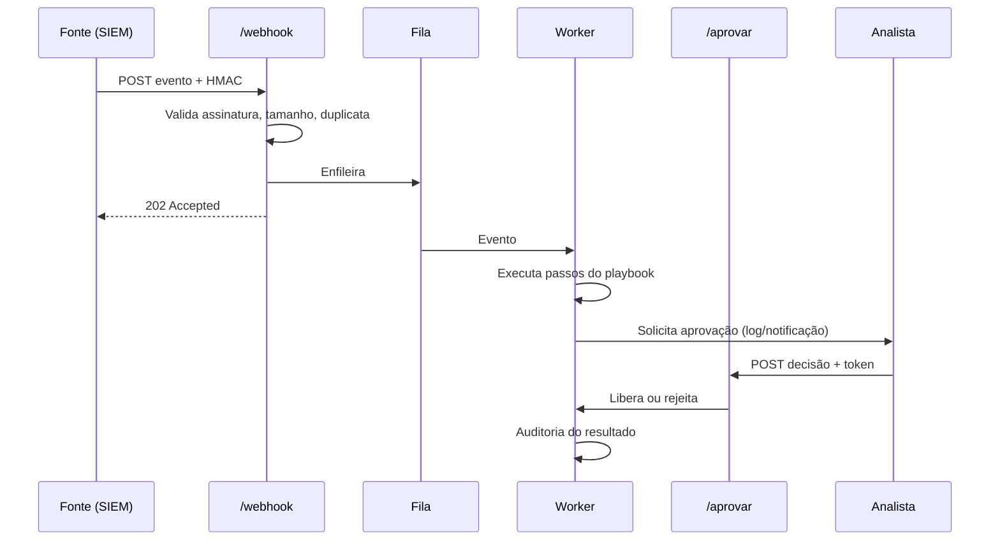

# Projeto 4 - Mini-SOAR com Webhook Fila e Playbook

> [!warning] Laboratório
> Execute os exercícios apenas em ambiente isolado e autorizado, com dados sintéticos e credenciais de teste.

## Resumo

Neste projeto você cria um **mini-SOAR** didático: um receptor de **webhook** autenticado por HMAC, uma **fila** interna, um **executor de playbooks** em YAML e uma etapa de **aprovação humana** antes de ações de contenção. As ações são **simuladas** (apenas registram o que fariam), o que permite estudar a arquitetura sem risco. O projeto integra webhooks, idempotência, filas, playbooks, human-in-the-loop e auditoria.

## Objetivo

Receber alertas de forma segura, enfileirar, executar um playbook declarativo e exigir aprovação para ações de risco, deixando uma trilha de auditoria.

## Pré-requisitos

- Python 3.11+, `fastapi`, `uvicorn`, `pyyaml`, `httpx` e `pytest` (para testes).
- Leitura prévia: [[Webhooks e Polling]], [[Idempotência]], [[Playbooks e Runbooks]], [[Human-in-the-Loop]], [[Auditoria e Logs de Ações]].
- Variáveis `WEBHOOK_SECRET` e `APPROVER_TOKEN` definidas no ambiente (valores de laboratório).

## Conceitos-chave

- Assinatura HMAC com timestamp (anti-replay) e limite de tamanho.
- Deduplicação por `id` do evento (SQLite).
- Fila em memória com *worker* (substituível por RabbitMQ).
- Playbook com allowlist de ações.
- Aprovação com token e expiração.
- Auditoria em JSON Lines.

## Como funciona



## Passo a passo

1. Crie `minisoar.py` e `playbooks/brute_force.yml` conforme abaixo.
2. Exporte as variáveis e rode `uvicorn minisoar:app --port 8000`.
3. Gere uma assinatura e envie um evento de teste com `curl` (script no código).
4. Observe no console o pedido de aprovação, aprove com `curl` e leia `auditoria.jsonl`.
5. Reenvie o mesmo `id` e confirme a resposta `duplicado`.
6. Envie com assinatura errada e confirme `401`.
7. Escreva os testes de assinatura e de duplicidade.

## Exemplo prático

### Playbook

```yaml
# playbooks/brute_force.yml
nome: brute-force
passos:
  - acao: enriquecer
  - acao: notificar
  - acao: bloquear_ip
    requer_aprovacao: true
```

### Código de referência

```python
# minisoar.py
import hashlib, hmac, json, os, queue, secrets, sqlite3, threading, time
from datetime import datetime, timezone
import yaml
from fastapi import FastAPI, Header, HTTPException, Request

SEGREDO = os.environ["WEBHOOK_SECRET"].encode()
TOKEN_APROVADOR = os.environ["APPROVER_TOKEN"]
FILA: queue.Queue = queue.Queue(maxsize=1000)
APROVACOES: dict[str, dict] = {}
db = sqlite3.connect("minisoar.db", check_same_thread=False)
db.execute("CREATE TABLE IF NOT EXISTS vistos (id TEXT PRIMARY KEY)")
app = FastAPI()

def auditar(**ev):
    ev["ts"] = datetime.now(timezone.utc).isoformat()
    with open("auditoria.jsonl", "a", encoding="utf-8") as f:
        f.write(json.dumps(ev, ensure_ascii=False) + "\n")

# ---- ações permitidas (simuladas) ----
def enriquecer(ev): return {"reputacao": "desconhecida"}
def notificar(ev): print(f"[NOTIFICA] {ev.get('regra')} de {ev.get('ip')}"); return {}
def bloquear_ip(ev): print(f"[SIMULADO] bloquearia {ev.get('ip')}"); return {}
ACOES = {"enriquecer": enriquecer, "notificar": notificar, "bloquear_ip": bloquear_ip}

def carregar_playbooks():
    pb = {}
    for nome in os.listdir("playbooks"):
        with open(os.path.join("playbooks", nome), encoding="utf-8") as f:
            d = yaml.safe_load(f)                       # safe_load
        for p in d["passos"]:
            assert p["acao"] in ACOES, f"ação desconhecida: {p['acao']}"
        pb[d["nome"]] = d
    return pb
PLAYBOOKS = carregar_playbooks()

@app.post("/webhook", status_code=202)
async def webhook(req: Request, x_signature: str = Header(""), x_timestamp: str = Header("0")):
    corpo = await req.body()
    if len(corpo) > 100_000:
        raise HTTPException(413, "corpo grande demais")
    try:
        ts = int(x_timestamp)
    except ValueError:
        raise HTTPException(401, "timestamp inválido")
    if abs(time.time() - ts) > 300:
        raise HTTPException(401, "fora da janela")
    esperado = hmac.new(SEGREDO, f"{ts}.".encode() + corpo, hashlib.sha256).hexdigest()
    if not hmac.compare_digest(esperado, x_signature):
        auditar(evento="assinatura_invalida")
        raise HTTPException(401, "assinatura inválida")
    ev = json.loads(corpo)
    try:
        with db:
            db.execute("INSERT INTO vistos VALUES (?)", (ev["id"],))
    except sqlite3.IntegrityError:
        return {"status": "duplicado"}
    try:
        FILA.put_nowait(ev)
    except queue.Full:
        raise HTTPException(503, "fila cheia")
    auditar(evento="recebido", id=ev["id"])
    return {"status": "aceito"}

@app.post("/aprovar/{aid}")
async def aprovar(aid: str, req: Request, x_token: str = Header("")):
    if not hmac.compare_digest(x_token, TOKEN_APROVADOR):
        raise HTTPException(401, "não autorizado")
    ap = APROVACOES.get(aid)
    if not ap:
        raise HTTPException(404, "inexistente")
    ap["decisao"] = (await req.json()).get("decisao", "rejeitar")
    ap["evento"].set()
    return {"ok": True}

def esperar_aprovacao(ev, passo, ttl=900) -> bool:
    aid = secrets.token_urlsafe(8)
    APROVACOES[aid] = {"evento": threading.Event(), "decisao": None}
    print(f"[APROVAÇÃO] POST /aprovar/{aid} para '{passo['acao']}' (alvo {ev.get('ip')})")
    ok = APROVACOES[aid]["evento"].wait(timeout=ttl)
    decisao = APROVACOES.pop(aid)["decisao"] if ok else "expirado"
    auditar(evento="aprovacao", id=ev["id"], acao=passo["acao"], decisao=decisao)
    return decisao == "aprovar"

def worker():
    while True:
        ev = FILA.get()
        pb = PLAYBOOKS.get(ev.get("tipo"))
        if not pb:
            auditar(evento="sem_playbook", id=ev.get("id")); continue
        for passo in pb["passos"]:
            if passo.get("requer_aprovacao") and not esperar_aprovacao(ev, passo):
                auditar(evento="passo_nao_executado", id=ev["id"], acao=passo["acao"]); continue
            ACOES[passo["acao"]](ev)
            auditar(evento="passo_executado", id=ev["id"], acao=passo["acao"])

threading.Thread(target=worker, daemon=True).start()
```

### Enviando um evento de teste

```python
# enviar_teste.py
import hashlib, hmac, json, os, time, requests

corpo = json.dumps({"id": "evt-001", "tipo": "brute_force", "regra": "ssh-bruteforce",
                    "ip": "203.0.113.7"}).encode()
ts = int(time.time())
assinatura = hmac.new(os.environ["WEBHOOK_SECRET"].encode(),
                      f"{ts}.".encode() + corpo, hashlib.sha256).hexdigest()
r = requests.post("http://127.0.0.1:8000/webhook", data=corpo, timeout=10,
                  headers={"X-Signature": assinatura, "X-Timestamp": str(ts),
                           "Content-Type": "application/json"})
print(r.status_code, r.text)
```

## Critérios de conclusão

- Evento com assinatura válida retorna `202`; inválida retorna `401`; repetido retorna `duplicado`.
- `bloquear_ip` só executa após aprovação; sem resposta em 15 minutos, não executa.
- `auditoria.jsonl` registra recebimento, passos, decisões e rejeições.
- Playbooks com ação desconhecida impedem a inicialização.
- Nenhuma ação real é executada (modo simulado).

## Extensões

- Trocar a fila por RabbitMQ com DLQ ([[Filas e Streaming - Kafka e RabbitMQ]]).
- Aprovação por botões no Slack com validação de assinatura ([[Integração com Mensageria - Slack e Teams]]).
- Encadeamento por hash na auditoria ([[Auditoria e Logs de Ações]]).
- Chamar o enriquecedor do [[Projeto 3 - Enriquecedor de Alertas com VirusTotal e MISP]].
- Métricas MTTD/MTTR ([[Métricas - MTTD e MTTR]]).

## Boas práticas

- Mantenha o endpoint de aprovação em rede restrita e com autenticação forte.
- Execute o serviço com o hardening de [[Privilégio Mínimo e Hardening de Containers]].
- Persistir o estado das aprovações permitiria retomar após reinício.

## Erros comuns

- O worker bloqueia enquanto espera a aprovação: em produção, use estado persistido e retomada.
- Token de aprovação fixo em ambiente compartilhado.
- Executar ações reais sem testes e sem reversão.

## Referências para aprofundar

- Documentação do Shuffle e do TheHive para comparar os conceitos; NIST SP 800-61.

## Veja também

- [[SOAR - Shuffle TheHive Cortex e n8n]]
- [[Playbooks e Runbooks]]
- [[Human-in-the-Loop]]
- [[Webhooks e Polling]]
- [[MOC - Projetos Práticos]]

#seguranca/projetos/mini-soar #seguranca/automacao/soar
