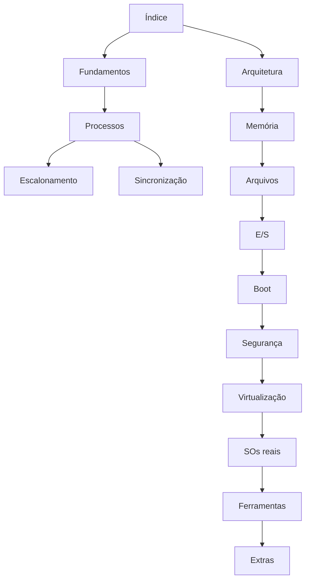

# Índice Geral - SO

> [!info] Comece aqui
> Vault de estudos de Sistemas Operacionais, do básico ao avançado. Veja [[Como Usar este Vault - SO]] e siga o [[Mapa de Estudos]].

## 00 - Início

- [[Como Usar este Vault - SO|Como Usar este Vault]]
- [[Índice Geral - SO|Índice Geral (MOC)]]

## 01 - Fundamentos

- [[MOC - Fundamentos - SO|MOC - Fundamentos]] (MOC)
- [[História e Evolução dos Sistemas Operacionais|História e Evolução dos Sistemas Operacionais]]
- [[Interrupções|Interrupções]]
- [[Kernel vs User Space|Kernel vs User Space]]
- [[Modos de Operação da CPU|Modos de Operação da CPU]]
- [[O que é um Sistema Operacional|O que é um Sistema Operacional]]
- [[SO em Lote (Batch)|SO em Lote (Batch)]]
- [[SO Distribuído|SO Distribuído]]
- [[SO Embarcado|SO Embarcado]]
- [[SO Mobile|SO Mobile]]
- [[SO de Tempo Compartilhado|SO de Tempo Compartilhado]]
- [[SO de Tempo Real (RTOS)|SO de Tempo Real (RTOS)]]
- [[System Calls|System Calls]]
- [[Tipos de Sistemas Operacionais|Tipos de Sistemas Operacionais]]
- [[Traps e Exceções|Traps e Exceções]]

## 02 - Arquitetura

- [[MOC - Arquitetura de Kernels|MOC - Arquitetura de Kernels]] (MOC)
- [[Arquitetura em Camadas|Arquitetura em Camadas]]
- [[Comparação de Arquiteturas com Exemplos Reais|Comparação de Arquiteturas com Exemplos Reais]]
- [[Exokernel|Exokernel]]
- [[Kernel Híbrido|Kernel Híbrido]]
- [[Kernel Monolítico|Kernel Monolítico]]
- [[Microkernel|Microkernel]]
- [[Unikernel|Unikernel]]

## 03 - Processos e Threads

- [[MOC - Processos e Threads|MOC - Processos e Threads]] (MOC)
- [[Context Switch (Troca de Contexto)|Context Switch (Troca de Contexto)]]
- [[Criação e Término de Processos|Criação e Término de Processos]]
- [[Estados de Processo|Estados de Processo]]
- [[IPC - Comunicação entre Processos|IPC - Comunicação entre Processos]]
- [[PCB - Process Control Block|PCB - Process Control Block]]
- [[Pipes|Pipes]]
- [[Processos|Processos]]
- [[Sinais|Sinais]]
- [[Sockets|Sockets]]
- [[Threads - SO|Threads]]

## 04 - Escalonamento

- [[MOC - Escalonamento|MOC - Escalonamento]] (MOC)
- [[CFS - Completely Fair Scheduler|CFS - Completely Fair Scheduler]]
- [[Escalonamento de Tempo Real|Escalonamento de Tempo Real]]
- [[Escalonamento de Processos|Escalonamento de Processos]]
- [[Escalonamento por Prioridades|Escalonamento por Prioridades]]
- [[FCFS - First Come, First Served|FCFS - First Come, First Served]]
- [[MLFQ - Multilevel Feedback Queue|MLFQ - Multilevel Feedback Queue]]
- [[Round Robin|Round Robin]]
- [[SJF e SRTF - Menor Job Primeiro|SJF e SRTF - Menor Job Primeiro]]

## 05 - Sincronização

- [[MOC - Sincronização|MOC - Sincronização]] (MOC)
- [[Condições de Corrida|Condições de Corrida]]
- [[Deadlock (Impasse)|Deadlock (Impasse)]]
- [[Monitores e Variáveis de Condição|Monitores e Variáveis de Condição]]
- [[Mutex|Mutex]]
- [[Operações Atômicas e Spinlocks|Operações Atômicas e Spinlocks]]
- [[Problemas Clássicos de Sincronização|Problemas Clássicos de Sincronização]]
- [[Seção Crítica|Seção Crítica]]
- [[Semáforos|Semáforos]]
- [[Soluções para Deadlock|Soluções para Deadlock]]

## 06 - Memória

- [[MOC - Gerenciamento de Memória|MOC - Gerenciamento de Memória]] (MOC)
- [[Algoritmos de Substituição de Páginas|Algoritmos de Substituição de Páginas]]
- [[Alocadores de Memória|Alocadores de Memória]]
- [[Gerenciamento de Memória|Gerenciamento de Memória]]
- [[Memória Virtual|Memória Virtual]]
- [[Page Faults|Page Faults]]
- [[Paginação|Paginação]]
- [[Segmentação|Segmentação]]
- [[Swap e Thrashing|Swap e Thrashing]]
- [[TLB - Translation Lookaside Buffer|TLB - Translation Lookaside Buffer]]

## 07 - Sistemas de Arquivos

- [[MOC - Sistemas de Arquivos|MOC - Sistemas de Arquivos]] (MOC)
- [[APFS|APFS]]
- [[Btrfs|Btrfs]]
- [[Inodes|Inodes]]
- [[Journaling e Copy-on-Write|Journaling e Copy-on-Write]]
- [[NTFS|NTFS]]
- [[Permissões de Arquivos|Permissões de Arquivos]]
- [[Sistemas de Arquivos - Conceitos|Sistemas de Arquivos - Conceitos]]
- [[VFS - Virtual File System|VFS - Virtual File System]]
- [[ZFS|ZFS]]
- [[ext4|ext4]]

## 08 - Entrada e Saída

- [[MOC - Entrada e Saída|MOC - Entrada e Saída]] (MOC)
- [[Buffering, Cache e Spooling|Buffering, Cache e Spooling]]
- [[DMA - Acesso Direto à Memória|DMA - Acesso Direto à Memória]]
- [[Dispositivos de Bloco e de Caractere|Dispositivos de Bloco e de Caractere]]
- [[Drivers de Dispositivo|Drivers de Dispositivo]]
- [[Entrada e Saída (E-S)|Entrada e Saída (E/S)]]
- [[Escalonadores de Disco|Escalonadores de Disco]]

## 09 - Boot

- [[MOC - Boot|MOC - Boot]] (MOC)
- [[BIOS e UEFI|BIOS e UEFI]]
- [[Bootloader|Bootloader]]
- [[Init e systemd|Init e systemd]]
- [[Processo de Boot|Processo de Boot]]

## 10 - Segurança

- [[MOC - Segurança - SO|MOC - Segurança]] (MOC)
- [[ASLR - Address Space Layout Randomization|ASLR - Address Space Layout Randomization]]
- [[Autenticação|Autenticação]]
- [[Controle de Acesso|Controle de Acesso]]
- [[DEP, NX e Mitigações de Exploração|DEP, NX e Mitigações de Exploração]]
- [[SELinux e AppArmor|SELinux e AppArmor]]
- [[Sandboxing|Sandboxing]]

## 11 - Virtualização e Containers

- [[MOC - Virtualização e Containers|MOC - Virtualização e Containers]] (MOC)
- [[Containers|Containers]]
- [[Docker|Docker]]
- [[Hypervisors|Hypervisors]]
- [[Namespaces do Linux - SO|Namespaces do Linux]]
- [[Virtualização|Virtualização]]
- [[cgroups - SO|cgroups]]

## 12 - Sistemas Operacionais Reais

- [[MOC - Sistemas Operacionais Reais|MOC - Sistemas Operacionais Reais]] (MOC)
- [[Android|Android]]
- [[Comparativo Final de Sistemas Operacionais|Comparativo Final de Sistemas Operacionais]]
- [[FreeBSD|FreeBSD]]
- [[Linux|Linux]]
- [[Minix|Minix]]
- [[QNX|QNX]]
- [[Windows NT|Windows NT]]
- [[iOS|iOS]]
- [[macOS e XNU|macOS e XNU]]

## 13 - Ferramentas Linux

- [[MOC - Ferramentas Nativas do Linux|MOC - Ferramentas Nativas do Linux]] (MOC)
- [[awk|awk]]
- [[chmod e chown|chmod e chown]]
- [[cron|cron]]
- [[df e du|df e du]]
- [[dmesg|dmesg]]
- [[free|free]]
- [[grep|grep]]
- [[iostat|iostat]]
- [[ip|ip]]
- [[journalctl|journalctl]]
- [[lsof|lsof]]
- [[mount|mount]]
- [[ps|ps]]
- [[sed|sed]]
- [[ss|ss]]
- [[strace|strace]]
- [[systemctl|systemctl]]
- [[top e htop|top e htop]]
- [[vmstat|vmstat]]

## 14 - Ferramentas Windows

- [[MOC - Ferramentas Nativas do Windows|MOC - Ferramentas Nativas do Windows]] (MOC)
- [[cmd (Prompt de Comando)|cmd (Prompt de Comando)]]
- [[Event Viewer (Visualizador de Eventos)|Event Viewer (Visualizador de Eventos)]]
- [[Gerenciador de Tarefas|Gerenciador de Tarefas]]
- [[netstat|netstat]]
- [[Perfmon (Monitor de Desempenho)|Perfmon (Monitor de Desempenho)]]
- [[PowerShell|PowerShell]]
- [[Regedit (Editor do Registro)|Regedit (Editor do Registro)]]
- [[Resource Monitor (Monitor de Recursos)|Resource Monitor (Monitor de Recursos)]]
- [[SFC e DISM|SFC e DISM]]
- [[Task Scheduler (Agendador de Tarefas)|Task Scheduler (Agendador de Tarefas)]]

## 15 - Ferramentas macOS

- [[MOC - Ferramentas Nativas do macOS|MOC - Ferramentas Nativas do macOS]] (MOC)
- [[Activity Monitor (Monitor de Atividade)|Activity Monitor (Monitor de Atividade)]]
- [[Console e Unified Logging|Console e Unified Logging]]
- [[Terminal (zsh e utilitários)|Terminal (zsh e utilitários)]]
- [[diskutil|diskutil]]
- [[dtrace|dtrace]]
- [[fs_usage|fs_usage]]
- [[launchd|launchd]]

## 16 - Extras

- [[MOC - Extras|MOC - Extras]] (MOC)
- [[Cheat Sheet - Comandos|Cheat Sheet - Comandos]]
- [[Cheat Sheet - Conceitos|Cheat Sheet - Conceitos]]
- [[Exercícios com Gabarito|Exercícios com Gabarito]]
- [[Glossário#Sistemas Operacionais|Glossário]]
- [[Mapa de Estudos|Mapa de Estudos]]
- [[Referências Recomendadas|Referências Recomendadas]]

## Estatísticas

- Pastas temáticas: 16
- Notas catalogadas: 156

## Veja também

[[Como Usar este Vault - SO]] · [[Mapa de Estudos]] · [[Glossário#Sistemas Operacionais]] · [[Comparativo Final de Sistemas Operacionais]]
