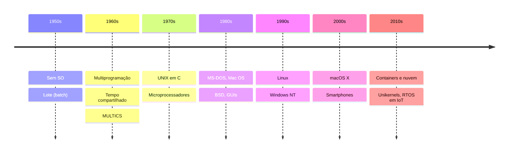

# História e Evolução dos Sistemas Operacionais

## Resumo

A evolução dos SOs acompanha a do hardware: cada salto (válvulas, transistores, circuitos integrados, microprocessadores, mobilidade, nuvem) exigiu novas abstrações para usar melhor máquinas cada vez mais baratas e poderosas.

## Gerações

| Período | Hardware | Característica do software |
|---|---|---|
| 1945-1955 | Válvulas | Sem SO; programação em linguagem de máquina e painéis |
| 1955-1965 | Transistores | Processamento em lote ([[SO em Lote (Batch)]]), monitores residentes, FORTRAN/IBM 7094 |
| 1965-1980 | Circuitos integrados | Multiprogramação, [[SO de Tempo Compartilhado]], OS/360, CTSS, MULTICS, UNIX (1969-1971) |
| 1980-1990 | Microprocessadores / PC | CP/M, MS-DOS, Mac OS, GUIs, BSD, redes |
| 1990-2000 | PCs poderosos | Linux (1991), Windows NT (1993), FreeBSD, memória protegida em desktops |
| 2000-2010 | Internet, multicore | macOS X (XNU), Windows XP/7, virtualização popular, smartphones |
| 2010-hoje | Nuvem, mobile, IoT | Android/iOS, containers, hypervisors leves, unikernels, RTOS em larga escala |

## Marcos importantes

- **CTSS (1961)** e **MULTICS (1964-69)**: tempo compartilhado e conceitos de segurança, anéis de proteção, memória virtual segmentada.
- **UNIX (Bell Labs, 1969)**: Ken Thompson e Dennis Ritchie; reescrito em C em 1973; filosofia "faça uma coisa bem feita", tudo é arquivo, pipes.
- **BSD (Berkeley)**: pilha TCP/IP, memória virtual paginada, base de FreeBSD e do macOS.
- **MS-DOS (1981)**: monotarefa, sem proteção; **Windows NT (1993)** trouxe kernel moderno com proteção e portabilidade.
- **Minix (1987)**: SO didático de Tanenbaum baseado em microkernel; inspirou Linus Torvalds.
- **Linux (1991)**: kernel monolítico modular, licença GPL; domina servidores, nuvem e Android.
- **Android (2008) e iOS (2007)**: SOs móveis, com sandbox por aplicação.



## Tendências de longo prazo

- De **monotarefa** para **multitarefa** com proteção.
- De **um computador por vários usuários** (mainframe) para **um usuário por vários dispositivos** e de volta a **muitos serviços em poucos servidores** (nuvem).
- Tamanho de kernel x modularidade: debate monolítico x microkernel ([[Comparação de Arquiteturas com Exemplos Reais]]).
- Isolamento mais leve: de máquinas virtuais a [[Containers]] e unikernels ([[Unikernel]]).

> [!tip] Curiosidade
> O primeiro grande sistema Unix portável só foi possível porque foi reescrito em C, uma linguagem criada para isso. É por isso que muitas partes de kernels modernos ainda são escritas em C (e, em Linux, também em Rust).

## Exemplo prático

```bash
# Em Linux, veja a versão do kernel e a distribuição
uname -a
cat /etc/os-release
```

## Pontos-chave

- Cada geração de hardware motivou novas abstrações no SO.
- UNIX e seus descendentes (BSD, Linux, macOS) formam a linhagem dominante.
- Windows NT tem linhagem própria, inspirada em VMS e Mach.

## Veja também

[[O que é um Sistema Operacional]] · [[Tipos de Sistemas Operacionais]] · [[MOC - Fundamentos - SO]]
