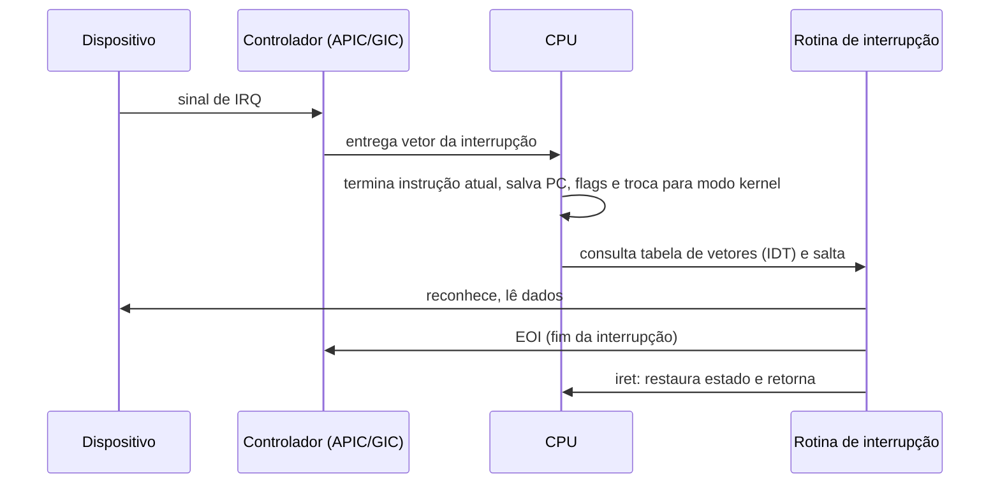

# Interrupções

## Resumo

Uma **interrupção** é um sinal que faz a CPU suspender o que executa, salvar o estado mínimo e saltar para uma rotina do kernel (**ISR**, *Interrupt Service Routine*). É o mecanismo que permite ao hardware avisar eventos de forma **assíncrona**: tecla pressionada, pacote de rede, fim de operação de disco, tique do timer.

## Tipos

| Tipo | Origem | Síncrona? | Exemplos |
|---|---|---|---|
| Interrupção de hardware (IRQ) | Dispositivo externo | Não | Timer, teclado, placa de rede, disco |
| Interrupção entre CPUs (IPI) | Outra CPU | Não | Invalidação de TLB, reescalonamento |
| Exceção / trap | Instrução em execução | Sim | Falta de página, divisão por zero, syscall |

Ver [[Traps e Exceções]] para o segundo grupo.

## Ciclo de tratamento



## Top half e bottom half

Para manter a latência baixa, o tratamento é dividido:

- **Top half (hardirq)**: roda com interrupções mascaradas; faz o mínimo (reconhece o dispositivo, copia dados, agenda trabalho).
- **Bottom half**: o trabalho restante roda depois, com interrupções habilitadas. No Linux: **softirq**, **tasklet**, **workqueue** e **threaded IRQ**.

> [!warning] Regras de ISR
> Uma ISR não pode dormir nem bloquear (sem `mutex`, sem alocação que durma), pois não há processo associado. Deve ser curta.

## Controle e prioridade

- **Máscara de interrupções**: `cli`/`sti` (x86) desabilitam/habilitam; o kernel usa seções críticas curtas com isso.
- **Prioridades**: o APIC/GIC prioriza IRQs; NMI (não mascarável) é para erros graves.
- **Interrupções por mensagem (MSI/MSI-X)**: o dispositivo escreve em um endereço em vez de usar linha física; permite várias filas por dispositivo.
- **Afinidade**: distribuir IRQs entre CPUs (`irqbalance`).
- **Polling x interrupção**: com tráfego muito alto, *polling* evita tempestade de interrupções (NAPI no Linux).

## Papel na multitarefa

A interrupção periódica do **timer** é o coração da preempção: ao fim do quantum, o kernel executa [[Context Switch (Troca de Contexto)]]. Ver [[SO de Tempo Compartilhado]].

## Exemplo prático

```bash
# Ver contagem de interrupções por CPU e por dispositivo
cat /proc/interrupts | head -15

# Ver softirqs
cat /proc/softirqs

# Ver afinidade de uma IRQ (ex.: IRQ 30) e alterar para a CPU 2
cat /proc/irq/30/smp_affinity_list
echo 2 | sudo tee /proc/irq/30/smp_affinity_list
```

Saída comentada (trecho de `/proc/interrupts`):

```text
           CPU0       CPU1
  0:         42          0   IO-APIC   2-edge      timer      # timer legado
 27:      18234      20211   PCI-MSI   524288-edge enp3s0     # placa de rede
```

Esqueleto de driver Linux registrando uma ISR:

```c
static irqreturn_t meu_isr(int irq, void *dev_id) {
    /* top half: reconhecer e agendar trabalho */
    return IRQ_HANDLED;
}
/* no probe do driver */
request_irq(irq, meu_isr, IRQF_SHARED, "meu_dispositivo", dev);
```

## Vantagens e desvantagens

| Vantagens | Desvantagens |
|---|---|
| CPU não perde tempo consultando dispositivos (*polling*) | Sobrecarga por interrupção (troca de contexto parcial) |
| Resposta rápida a eventos | Tempestade de interrupções pode degradar o sistema |
| Base da preempção e do tempo compartilhado | Concorrência complexa nas seções críticas |

## Pontos-chave

- Interrupção = evento **assíncrono** de hardware; exceção = evento **síncrono** da instrução.
- ISR deve ser curta; trabalho pesado vai para o bottom half.
- O timer gera as interrupções que viabilizam a preempção.

## Veja também

[[Traps e Exceções]] · [[System Calls]] · [[Drivers de Dispositivo]] · [[DMA - Acesso Direto à Memória]] · [[MOC - Fundamentos - SO]]
