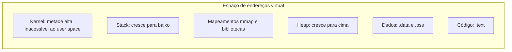

# Kernel vs User Space

## Resumo

O **kernel** é o núcleo do SO e roda com privilégio total. Todo o resto (aplicações, bibliotecas, shells, muitos serviços) roda em **user space**, com privilégio reduzido. A fronteira é imposta pelo **hardware** (modos da CPU e MMU) e atravessada somente por [[System Calls]], [[Interrupções]] e [[Traps e Exceções]].

## Comparação

| Característica | Kernel space | User space |
|---|---|---|
| Modo da CPU | Privilegiado (ring 0 / EL1) | Não privilegiado (ring 3 / EL0) |
| Acesso ao hardware | Direto | Proibido; só via kernel |
| Memória | Vê toda a memória física e a do kernel | Vê apenas seu espaço virtual |
| Falha | Pode derrubar o sistema (*kernel panic*, BSOD) | Derruba só o processo |
| Código típico | Escalonador, drivers, sistema de arquivos, rede | Aplicações, `libc`, serviços/daemons |

## Layout do espaço de endereços (x86-64 Linux, simplificado)



> [!info] Isolamento
> Cada processo tem seu espaço virtual próprio. As páginas do kernel são marcadas "somente supervisor" nas tabelas de páginas; um acesso do user space gera *page fault* e o processo recebe `SIGSEGV`. Ver [[Memória Virtual]].

## Por que separar?

- **Proteção**: um programa defeituoso não corrompe outro nem o kernel.
- **Estabilidade**: falhas ficam contidas.
- **Segurança**: só o kernel decide quem acessa qual recurso.
- **Abstração**: aplicações usam uma interface estável mesmo com hardware diferente.

> [!warning] Custo da fronteira
> Atravessar a fronteira custa centenas de ciclos (troca de modo, validação de argumentos, possível limpeza de TLB/cache em mitigações como KPTI). Por isso há otimizações como `vDSO` (leitura de tempo sem entrar no kernel) e `io_uring`.

## Exemplo prático

```bash
# Quanto tempo um processo gastou em user vs kernel
/usr/bin/time -v ls -R / > /dev/null 2>&1 | grep -E "User time|System time"

# Ver mapeamento de memória de um processo (inclui regiões [stack], [heap], [vdso])
cat /proc/self/maps | head
```

```c
// Tentar acessar memória do kernel a partir do user space causa SIGSEGV
#include <stdio.h>
int main(void) {
    volatile int *p = (int *)0xffff800000000000ULL; // endereço do kernel (x86-64)
    printf("%d\n", *p);  // Segmentation fault
    return 0;
}
```

## Onde cada arquitetura coloca os serviços

- [[Kernel Monolítico]]: quase tudo (drivers, FS, rede) no kernel space.
- [[Microkernel]]: só o essencial no kernel; drivers e FS em user space.

## Pontos-chave

- A fronteira é de hardware, não apenas convenção de software.
- Só [[System Calls]], interrupções e exceções cruzam essa fronteira.
- Um bug em kernel space é muito mais grave que em user space.

## Veja também

[[Modos de Operação da CPU]] · [[System Calls]] · [[MOC - Fundamentos - SO]]
