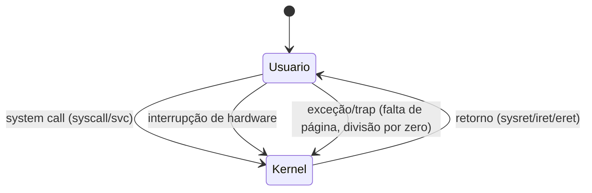

# Modos de Operação da CPU

## Resumo

A CPU possui ao menos dois **modos de privilégio**: **modo usuário** e **modo kernel (supervisor)**. Instruções sensíveis (acesso a E/S, alteração de tabelas de páginas, desabilitar interrupções) só funcionam no modo kernel. É a base da proteção em [[Kernel vs User Space]].

## Anéis de proteção e níveis por arquitetura

| Arquitetura | Níveis | Uso comum |
|---|---|---|
| x86 / x86-64 | Ring 0 a 3 | Ring 0 = kernel; ring 3 = usuário; rings 1 e 2 quase não usados |
| ARMv8-A | EL0 a EL3 | EL0 = app; EL1 = kernel; EL2 = hypervisor; EL3 = *secure monitor* |
| RISC-V | U, S, M (e H) | U = usuário; S = supervisor (kernel); M = máquina (firmware) |

> [!info] Hypervisors
> Com virtualização por hardware (Intel VT-x, AMD-V), surge um modo ainda mais privilegiado para o hypervisor (VMX root / EL2). O kernel convidado continua achando que está no ring 0. Ver [[Virtualização]].

## Como o bit de modo muda



- A **entrada** no modo kernel só ocorre por pontos definidos pelo kernel (tabela de interrupções/vetores, registrador de syscall), nunca por salto arbitrário.
- O **retorno** usa instruções específicas (`sysret`, `iretq`, `eret`) que restauram o modo e o ponteiro de instrução.

## Instruções privilegiadas (exemplos x86)

| Instrução | Função |
|---|---|
| `cli` / `sti` | Desabilitar/habilitar interrupções |
| `hlt` | Parar a CPU até a próxima interrupção |
| `lgdt` / `lidt` | Carregar tabelas de descritores |
| `mov cr3, ...` | Trocar a tabela de páginas |
| `in` / `out` | E/S em portas |
| `wrmsr` / `rdmsr` | Registradores específicos do modelo |

Tentar executar uma delas em modo usuário gera uma exceção (#GP) que o kernel trata, geralmente enviando `SIGSEGV`/`SIGILL` ao processo.

## Exemplo prático

```c
// Em user space, 'cli' causa "Segmentation fault" (general protection fault)
int main(void) {
    __asm__ volatile ("cli");
    return 0;
}
```

```bash
# Ver o nível de privilégio de execução através do contador em /proc (mudanças de contexto)
grep -E "voluntary_ctxt|nonvoluntary_ctxt" /proc/self/status
# Contadores de interrupções por CPU
head -5 /proc/interrupts
```

## Vantagens e desvantagens do modelo de dois modos

| Vantagens | Desvantagens |
|---|---|
| Simples e eficiente em hardware | Granularidade grossa: todo o kernel tem o mesmo poder |
| Base sólida de isolamento | Qualquer bug de driver compromete o sistema inteiro |
| Suportado por todas as CPUs modernas | Mitigações (KPTI) custam desempenho |

## Pontos-chave

- Dois modos mínimos: usuário e kernel; hypervisor adiciona um terceiro.
- Instruções privilegiadas só rodam no modo kernel.
- A troca de modo ocorre por [[System Calls]], [[Interrupções]] e [[Traps e Exceções]].

## Veja também

[[Kernel vs User Space]] · [[MOC - Fundamentos - SO]]
