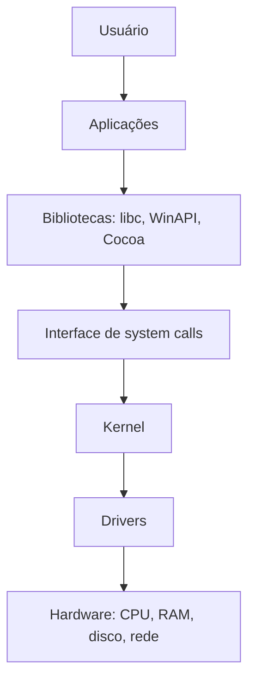

# O que é um Sistema Operacional

## Resumo

Um **sistema operacional (SO)** é o software que gerencia os recursos de hardware (CPU, memória, disco, rede, dispositivos) e fornece uma interface uniforme e segura para que programas de aplicação os utilizem.

## Duas visões complementares

| Visão | Papel do SO | Exemplo |
|---|---|---|
| **Máquina estendida** | Esconde a complexidade do hardware e oferece abstrações simples | "Arquivo" em vez de setores de disco; "processo" em vez de registradores e interrupções |
| **Gerenciador de recursos** | Arbitra o acesso concorrente a recursos limitados, com justiça, eficiência e proteção | Escalonador divide a CPU entre processos; gerenciador de memória divide a RAM |

## Responsabilidades principais

- **Gerência de processos**: criar, escalonar e finalizar execuções ([[Processos]], [[Threads - SO]]).
- **Gerência de memória**: alocar, proteger e virtualizar a memória ([[Memória Virtual]]).
- **Sistema de arquivos**: organizar dados persistentes com nomes, hierarquia e permissões ([[Sistemas de Arquivos - Conceitos]]).
- **Entrada/saída**: abstrair dispositivos por meio de [[Drivers de Dispositivo]].
- **Proteção e segurança**: isolar usuários e processos entre si.
- **Interface**: system calls para programas ([[System Calls]]) e shell/GUI para pessoas.

## Camadas do sistema



## Exemplo prático

Ao executar `cat arquivo.txt`, o shell pede ao kernel para criar um processo; o `cat` chama `open`, `read` e `write` (system calls); o kernel consulta o sistema de arquivos, o driver do disco lê os blocos e o resultado volta ao terminal.

```bash
# Veja as system calls que o cat realmente usa
strace -e trace=openat,read,write cat /etc/hostname
```

## Kernel, shell e utilitários: não são sinônimos

> [!info] Definições
> - **Kernel**: núcleo que roda com privilégio máximo e implementa as abstrações.
> - **Shell**: interpretador de comandos (bash, PowerShell, zsh).
> - **Distribuição/sistema completo**: kernel + bibliotecas + utilitários + gerenciador de pacotes. Linux, em sentido estrito, é só o kernel.

## Vantagens e desvantagens de ter um SO

| Vantagens | Desvantagens |
|---|---|
| Portabilidade das aplicações entre hardwares | Camada extra gera sobrecarga (latência, memória) |
| Isolamento e segurança entre programas | Kernel grande aumenta a superfície de ataque |
| Compartilhamento justo de recursos | Abstrações podem esconder detalhes necessários para desempenho extremo |
| Produtividade de desenvolvimento | Dependência de drivers e compatibilidade |

> [!tip] Quando NÃO usar SO
> Microcontroladores muito simples rodam **bare metal** (firmware em laço principal), sem SO. Ver [[SO Embarcado]].

## Pontos-chave

- SO = abstração + gerência de recursos + proteção.
- O kernel é a parte privilegiada; o restante roda em [[Kernel vs User Space|user space]].
- Todo acesso de aplicações a serviços privilegiados passa por [[System Calls]].

## Veja também

[[História e Evolução dos Sistemas Operacionais]] · [[Tipos de Sistemas Operacionais]] · [[Modos de Operação da CPU]] · [[MOC - Fundamentos - SO]]
