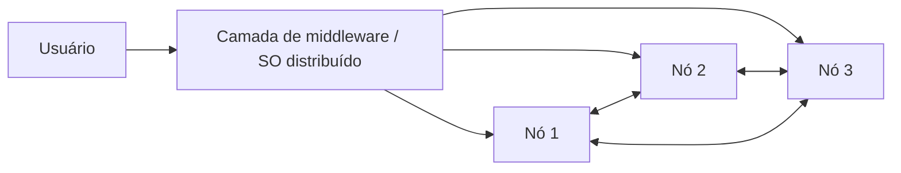

# SO Distribuído

## Resumo

Um **SO distribuído** coordena várias máquinas conectadas por rede de modo que, para o usuário, pareçam **um único sistema coerente** (transparência). Difere de apenas "rodar software distribuído sobre SOs comuns".

## Tipos de transparência

| Transparência | Significado |
|---|---|
| Acesso | Mesma operação para recurso local ou remoto |
| Localização | O nome não revela onde o recurso está |
| Migração | Recursos mudam de nó sem afetar o usuário |
| Replicação | Cópias invisíveis para o usuário |
| Falha | Falhas parciais mascaradas |
| Concorrência | Acesso simultâneo sem interferência |

## Problemas fundamentais

- **Sem relógio global**: usam relógios lógicos (Lamport) e vetoriais.
- **Falhas parciais**: um nó cai enquanto os outros continuam.
- **Consenso**: acordo entre nós (Paxos, Raft).
- **Teorema CAP**: sob partição de rede, escolhe-se entre consistência e disponibilidade.
- **Latência e largura de banda** da rede.



## Exemplos

| Sistema | Observação |
|---|---|
| Plan 9 (Bell Labs) | Tudo é arquivo, inclusive recursos remotos; namespaces por processo |
| Amoeba | Pesquisa; microkernel com objetos e capacidades |
| Kubernetes/Mesos | Não são SOs, mas funcionam como "SO do datacenter" sobre Linux |
| NFS, Ceph | Sistemas de arquivos distribuídos |

## Exemplo prático

Chamada remota de procedimento (RPC) simplificada em Python:

```python
# servidor.py
from xmlrpc.server import SimpleXMLRPCServer

def soma(a, b):
    return a + b

srv = SimpleXMLRPCServer(("0.0.0.0", 8000), allow_none=True)
srv.register_function(soma, "soma")
srv.serve_forever()
```

```python
# cliente.py - chamada parece local, mas executa em outro nó
import xmlrpc.client
proxy = xmlrpc.client.ServerProxy("http://localhost:8000/")
print(proxy.soma(2, 3))  # 5
```

## Vantagens e desvantagens

| Vantagens | Desvantagens |
|---|---|
| Escalabilidade horizontal | Complexidade extrema |
| Tolerância a falhas por replicação | Latência e partições de rede |
| Compartilhamento de recursos | Segurança mais difícil (superfície maior) |
| Custo-benefício com hardware comum | Depuração difícil |

> [!info] Na prática
> Na indústria, a ideia sobreviveu como **camada de software acima do SO local** (orquestradores, sistemas de arquivos distribuídos, bancos distribuídos), não como kernel único para todo o cluster.

## Pontos-chave

- Objetivo central: **transparência**.
- Os problemas centrais são relógios, falhas parciais e consenso.
- Base conceitual de nuvem e orquestração; ver [[Virtualização]].

## Veja também

[[Tipos de Sistemas Operacionais]] · [[MOC - Fundamentos - SO]]
