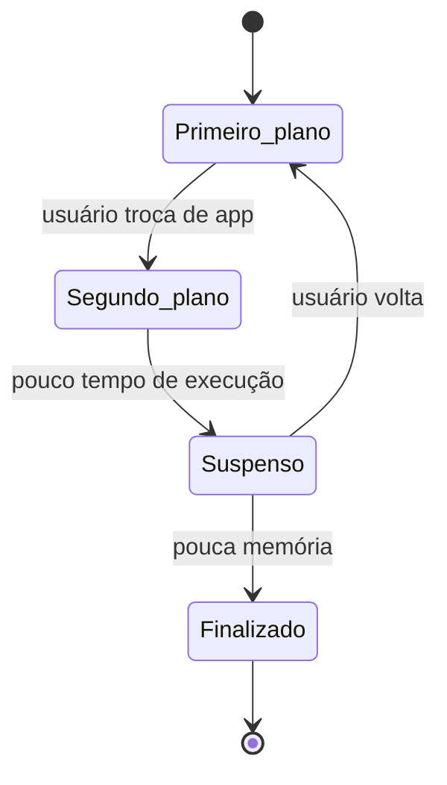

# SO Mobile

## Resumo

SOs móveis rodam em smartphones e tablets. São derivados de kernels de uso geral (Linux no [[Android]], XNU no [[iOS]]), mas redesenhados para **energia limitada, interface por toque, sensores, rede celular e aplicações isoladas**.

## Diferenças em relação a desktop/servidor

| Aspecto | Desktop/servidor | Mobile |
|---|---|---|
| Energia | Tomada ou grande bateria | Bateria; gestão agressiva de energia |
| Ciclo de vida de apps | Roda até o usuário fechar | O SO pode **suspender ou matar** apps em segundo plano |
| Segurança | Usuário confia nos programas | **Sandbox** por app e **permissões** em tempo de execução |
| Instalação | Qualquer fonte | Lojas curadas, assinatura de código |
| Memória | Swap em disco comum | Sem swap tradicional; compressão de memória e *low memory killer* |
| Interface | Teclado/mouse | Toque, sensores, câmera, GPS |

## Mecanismos típicos

- **Gerenciamento de energia**: *wakelocks* (Android), *doze mode*, agendamento de tarefas em lote, CPUs heterogêneas (big.LITTLE).
- **Ciclo de vida do app**: estados como em primeiro plano, em segundo plano e suspenso.
- **Sandbox e permissões**: cada app tem UID próprio no Android; no iOS, contêineres de app e *entitlements*. Ver [[Sandboxing]].
- **Inicialização verificada** (*verified boot*) e criptografia de armazenamento por padrão.
- **IPC próprio**: Binder (Android), XPC/Mach ports (iOS). Ver [[IPC - Comunicação entre Processos]].



## Exemplo prático

```bash
# Android (via adb): processos, memória e bateria
adb shell ps -A | head
adb shell dumpsys meminfo com.android.chrome | head -20
adb shell dumpsys battery
```

## Vantagens e desvantagens

| Vantagens | Desvantagens |
|---|---|
| Isolamento forte entre apps | Menos liberdade para o usuário e para desenvolvedores |
| Boa eficiência energética | Apps em segundo plano limitados |
| Atualizações e lojas centralizadas | Fragmentação (Android) ou dependência do fabricante (iOS) |

## Pontos-chave

- Mobile = uso geral + energia + sandbox + ciclo de vida controlado.
- Detalhes por plataforma em [[Android]] e [[iOS]].

## Veja também

[[Tipos de Sistemas Operacionais]] · [[MOC - Fundamentos - SO]]
