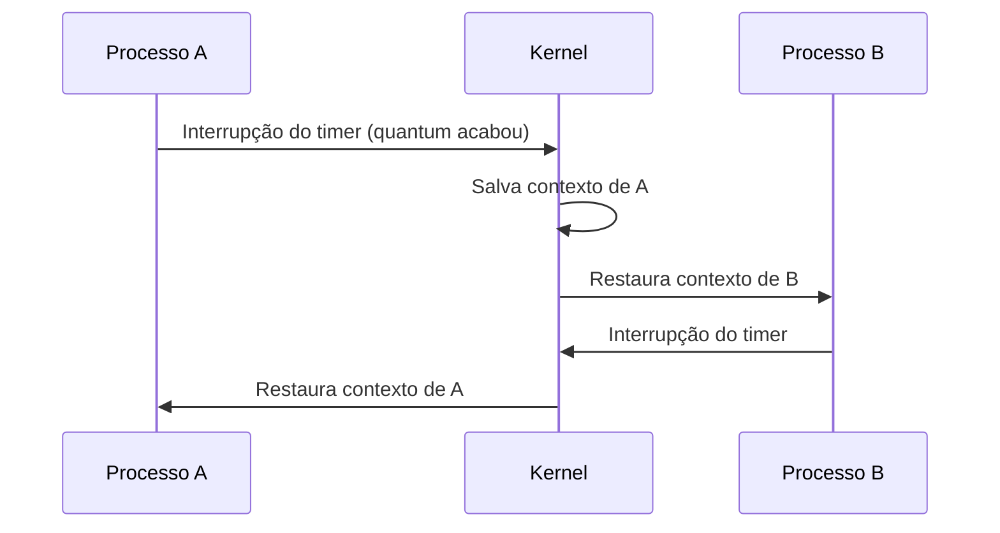

# SO de Tempo Compartilhado

## Resumo

Em **tempo compartilhado** (*time-sharing*), a CPU é dividida em fatias curtas (*quantum*) entre vários processos ou usuários, trocando tão rápido que cada um tem a ilusão de uso exclusivo. O objetivo é **baixo tempo de resposta**.

## Como funciona

1. Um **timer de hardware** gera interrupções periódicas ([[Interrupções]]).
2. No tratamento da interrupção, o kernel decide se o processo atual esgotou o quantum.
3. Se sim, executa um [[Context Switch (Troca de Contexto)]] e escolhe outro processo conforme o [[Escalonamento de Processos]].
4. Memória virtual e proteção permitem manter muitos processos residentes com isolamento.



## Requisitos

- **Preempção** (retirar a CPU à força).
- **Proteção de memória** entre processos.
- Gerenciamento de múltiplos terminais/sessões.
- Sistema de arquivos com permissões por usuário.

## Exemplo prático

```bash
# Ver a política de escalonamento e o quantum aproximado no Linux
cat /proc/sys/kernel/sched_rr_timeslice_ms
# Ver quantos context switches um processo sofreu
grep ctxt /proc/$$/status
```

```c
// Dois processos disputando a CPU: observe o intercalamento da saída
#include <stdio.h>
#include <unistd.h>

int main(void) {
    fork();
    for (int i = 0; i < 3; i++) {
        printf("pid=%d i=%d\n", getpid(), i);
        usleep(1000);
    }
    return 0;
}
```

## Vantagens e desvantagens

| Vantagens | Desvantagens |
|---|---|
| Boa interatividade | Sobrecarga de trocas de contexto |
| Vários usuários simultâneos | Exige mais memória e hardware de proteção |
| Uso eficiente da CPU durante esperas de E/S | Sem garantia de prazos (ver [[SO de Tempo Real (RTOS)]]) |

> [!warning] Quantum curto demais
> Se o quantum for menor que o custo do context switch, a CPU gasta mais tempo trocando do que trabalhando. O equilíbrio típico fica entre alguns milissegundos e dezenas de milissegundos.

## Pontos-chave

- Preempção por timer é o mecanismo central.
- Maioria dos SOs modernos de desktop e servidor é de tempo compartilhado.
- Qualidade percebida = tempo de resposta, não vazão.

## Veja também

[[Tipos de Sistemas Operacionais]] · [[MOC - Fundamentos - SO]]
