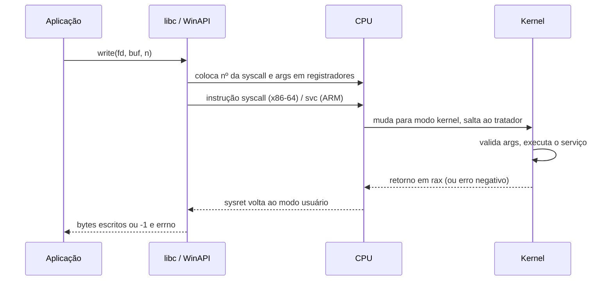

# System Calls

## Resumo

**System calls** (chamadas de sistema) são a interface oficial pela qual um programa em user space pede serviços ao kernel: abrir arquivos, criar processos, alocar memória, usar a rede. São o único caminho legítimo para o modo kernel a pedido do programa.

## Fluxo de uma chamada



## Convenção x86-64 Linux

| Registrador | Papel |
|---|---|
| `rax` | Número da syscall (entrada) e valor de retorno (saída) |
| `rdi, rsi, rdx, r10, r8, r9` | Argumentos 1 a 6 |
| `rcx`, `r11` | Sobrescritos pela instrução `syscall` (salvam RIP e RFLAGS) |

## Categorias

| Categoria | Linux | Windows (WinAPI) |
|---|---|---|
| Processos | `fork`, `execve`, `exit`, `wait4` | `CreateProcess`, `ExitProcess` |
| Arquivos | `open`, `read`, `write`, `close` | `CreateFile`, `ReadFile`, `WriteFile` |
| Memória | `mmap`, `brk`, `munmap` | `VirtualAlloc`, `VirtualFree` |
| Comunicação | `pipe`, `socket`, `kill` | `CreatePipe`, `WSASocket` |
| Informação | `getpid`, `uname`, `clock_gettime` | `GetCurrentProcessId` |

> [!info] Windows
> Programas Windows normalmente **não** chamam syscalls diretamente: usam a Win32 API (`kernel32.dll`), que chama `ntdll.dll`, que executa a instrução de syscall para o kernel NT. Os números de syscalls mudam entre versões; no Linux, são estáveis.

## Exemplo prático em C: com e sem libc

```c
#include <unistd.h>
#include <sys/syscall.h>

int main(void) {
    const char msg[] = "ola, kernel\n";
    write(1, msg, sizeof msg - 1);                    // via libc
    syscall(SYS_write, 1, msg, sizeof msg - 1);       // chamada direta pelo número
    return 0;
}
```

Syscall em assembly x86-64 (Linux), sem libc:

```c
// write(1, "oi\n", 3) em inline assembly
long ret;
__asm__ volatile (
    "syscall"
    : "=a"(ret)
    : "a"(1), "D"(1), "S"("oi\n"), "d"(3)
    : "rcx", "r11", "memory"
);
```

## Observando syscalls

```bash
strace -c ls                       # resumo: quantas chamadas e tempo gasto
strace -e trace=openat,read cat /etc/hostname
strace -f -o saida.txt ./programa  # segue filhos, grava em arquivo
```

Saída comentada (trecho):

```text
openat(AT_FDCWD, "/etc/hostname", O_RDONLY) = 3   # fd 3 = arquivo aberto
read(3, "meu-pc\n", 131072)            = 7        # leu 7 bytes
write(1, "meu-pc\n", 7)                = 7        # escreveu no stdout (fd 1)
close(3)                               = 0        # 0 = sucesso
```

Ver mais em [[strace]].

## Vantagens e desvantagens

| Vantagens | Desvantagens |
|---|---|
| Fronteira única e auditável | Custo da troca de modo em cada chamada |
| Permite filtros de segurança (`seccomp`) | Muitas syscalls = grande superfície de ataque |
| Interface estável (Linux) | Interfaces diferentes entre SOs dificultam portabilidade |

> [!tip] Reduzindo o custo
> Agrupe operações (`readv`, `writev`, `sendmmsg`), use buffering em user space (`stdio`), `mmap`, ou `io_uring` para submeter várias operações com poucas travessias.

## Pontos-chave

- System call = pedido do programa ao kernel por instrução especial.
- libc/WinAPI embrulha a chamada e traduz erros (`errno`).
- `strace` mostra todas as syscalls de um processo.

## Veja também

[[Kernel vs User Space]] · [[Traps e Exceções]] · [[Interrupções]] · [[MOC - Fundamentos - SO]]
