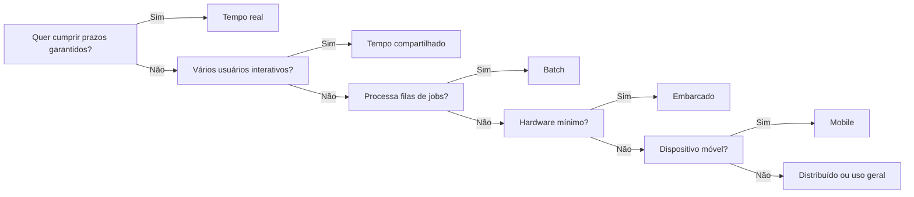

# Tipos de Sistemas Operacionais

## Resumo

SOs são classificados pelo **objetivo principal**: maximizar vazão, responder ao usuário, cumprir prazos, coordenar várias máquinas, caber em hardware mínimo ou rodar em dispositivos móveis.

## Quadro comparativo

| Tipo | Objetivo principal | Interação | Exemplos |
|---|---|---|---|
| [[SO em Lote (Batch)]] | Vazão (jobs por hora) | Nenhuma durante a execução | IBM OS/360 (lote), jobs de mainframe |
| [[SO de Tempo Compartilhado]] | Tempo de resposta | Interativa, vários usuários | UNIX, Linux, Windows, macOS |
| [[SO de Tempo Real (RTOS)]] | Previsibilidade de prazos | Reação a eventos externos | FreeRTOS, VxWorks, QNX, RTLinux |
| [[SO Distribuído]] | Transparência entre máquinas | Cluster visto como um sistema | Plan 9, Amoeba, clusters modernos |
| [[SO Embarcado]] | Pouco recurso, confiabilidade | Dedicada ao dispositivo | Zephyr, FreeRTOS, Linux embarcado |
| [[SO Mobile]] | Energia, toque, sandbox | Toque e sensores | Android, iOS |

## Eixos para classificar

- **Número de usuários**: monousuário x multiusuário.
- **Número de tarefas**: monotarefa x multitarefa.
- **Prazo**: tempo real *hard* (prazo perdido é falha) x *soft* (degrada qualidade).
- **Escopo**: máquina única x distribuído.
- **Recursos**: servidor/desktop x embarcado.



> [!warning] Categorias se sobrepõem
> Um Android é mobile, tempo compartilhado e, em dispositivos específicos, embarcado. O QNX é tempo real e embarcado. Classifique pela **característica dominante** em cada contexto.

## Exemplo prático

```bash
# Linux de uso geral pode ganhar comportamento de tempo real com PREEMPT_RT
uname -v | grep -i preempt
# Ver a política de escalonamento de um processo
chrt -p $$
```

## Pontos-chave

- Não existe "melhor tipo": cada um otimiza uma métrica diferente.
- Sistemas modernos de uso geral misturam características de vários tipos.
- A escolha do tipo influencia o [[Escalonamento de Processos]].

## Veja também

[[O que é um Sistema Operacional]] · [[História e Evolução dos Sistemas Operacionais]] · [[MOC - Fundamentos - SO]]
