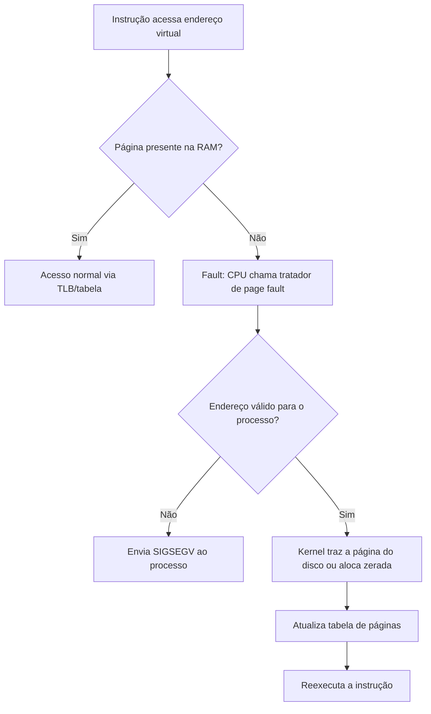

# Traps e Exceções

## Resumo

**Exceções** são eventos **síncronos** causados pela própria instrução em execução. A CPU transfere o controle ao kernel para tratar a condição. Dividem-se em **faults**, **traps** e **aborts**. A terminologia varia entre autores; aqui seguimos a classificação da arquitetura x86.

## Classificação

| Categoria | Quando é sinalizada | Retorno | Exemplos |
|---|---|---|---|
| **Fault** | Antes de completar a instrução; pode ser corrigida | Reexecuta a **mesma** instrução | Falta de página (#PF), proteção geral (#GP) |
| **Trap** | Depois de executar a instrução | Continua na **próxima** instrução | `syscall`/`int 0x80`, breakpoint (`int3`), single-step |
| **Abort** | Erro grave, estado perdido | Não retorna | Machine check, double fault |

> [!info] Syscall como trap
> Uma [[System Calls|system call]] é uma **trap intencional**: o programa executa uma instrução específica justamente para entrar no kernel.

## O caso mais importante: falta de página



Isso permite *demand paging* e *copy-on-write*, essenciais para `fork` rápido. Ver [[Paginação]] e [[Memória Virtual]].

## Exceções comuns

| Exceção | Causa | Resultado típico no Linux |
|---|---|---|
| Divisão por zero (#DE) | Divisor 0 | `SIGFPE` |
| Instrução inválida (#UD) | Opcode inexistente | `SIGILL` |
| Proteção geral (#GP) | Instrução privilegiada em modo usuário | `SIGSEGV` |
| Falta de página (#PF) | Página ausente ou acesso proibido | Corrige ou `SIGSEGV` |
| Breakpoint (#BP) | `int3` | `SIGTRAP` (depuradores) |

## Exemplo prático

```c
#include <stdio.h>
#include <signal.h>
#include <stdlib.h>

void tratador(int sig) {
    printf("recebi sinal %d (exceção virou sinal)\n", sig);
    exit(1);
}

int main(void) {
    signal(SIGFPE, tratador);
    volatile int zero = 0;
    printf("%d\n", 1 / zero);   // #DE na CPU -> kernel -> SIGFPE
    return 0;
}
```

```bash
# Contar page faults de um comando
/usr/bin/time -v ls / 2>&1 | grep -E "page faults"
# Depurador usa int3 para breakpoints
gdb -batch -ex "break main" -ex run ./programa
```

## Interrupção x exceção x syscall

| | Interrupção | Exceção | Syscall |
|---|---|---|---|
| Origem | Hardware externo | Instrução com problema | Instrução intencional |
| Sincronia | Assíncrona | Síncrona | Síncrona |
| Previsível? | Não | Em parte | Sim |
| Mesmo mecanismo de entrada no kernel? | Sim (vetor + modo kernel) | Sim | Sim (ou instrução rápida dedicada) |

## Pontos-chave

- Exceções são síncronas; interrupções, assíncronas.
- Fault é recuperável e reexecuta a instrução (ex.: page fault válido).
- O kernel traduz exceções não recuperáveis em **sinais** para o processo.

## Veja também

[[Interrupções]] · [[System Calls]] · [[Modos de Operação da CPU]] · [[MOC - Fundamentos - SO]]
