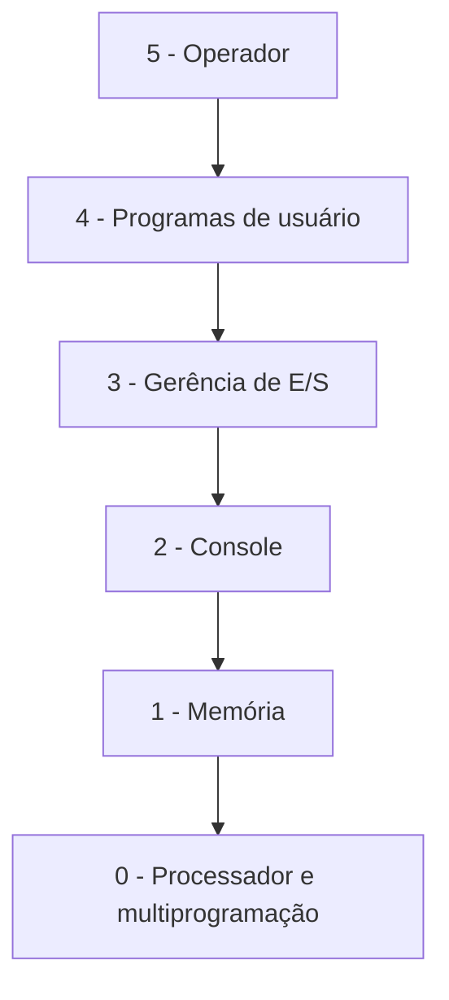
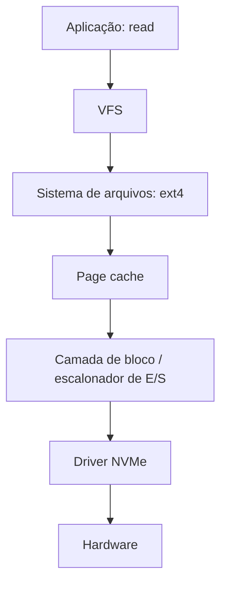

# Arquitetura em Camadas

## Resumo

Na arquitetura **em camadas**, o SO é dividido em níveis hierárquicos: a camada *n* usa **apenas** serviços da camada *n−1* e oferece serviços à camada *n+1*. A ideia reduz a complexidade (abstração, modularidade) e facilita depuração e verificação camada por camada.

## O sistema THE (Dijkstra, 1968)

O primeiro SO estruturado em camadas:

| Camada | Função |
|---|---|
| 5 | Operador/usuário |
| 4 | Programas de usuário |
| 3 | Gerência de entrada/saída |
| 2 | Comunicação operador-processo (console) |
| 1 | Gerência de memória e *drum* |
| 0 | Alocação de processador e multiprogramação |



## Camadas em sistemas reais

Sistemas reais raramente têm camadas estritas; usam **camadas frouxas**, em que uma camada pode chamar camadas inferiores não adjacentes:

- **Modelo de anéis (MULTICS)**: privilégios em anéis concêntricos.
- **Pilha de rede (TCP/IP)**: enlace, rede, transporte, aplicação (a camada em que o conceito mais funciona).
- **Pilha de armazenamento no Linux**: syscall, VFS, sistema de arquivos, cache de blocos, camada de bloco, driver, dispositivo.
- **Windows NT**: HAL, kernel, Executive, subsistemas ([[Kernel Híbrido]]).



## Exemplo prático

```bash
# Ver as camadas de armazenamento de um dispositivo (Linux)
lsblk -f
# Ver escalonador de E/S da camada de bloco
cat /sys/block/sda/queue/scheduler
# Ver pilha de rede por camadas (enlace e rede)
ip -s link show eth0
ss -s
```

## Vantagens e desvantagens

| Vantagens | Desvantagens |
|---|---|
| Modularidade e abstração claras | **Desempenho**: cada camada acrescenta sobrecarga |
| Depuração e verificação camada a camada | Difícil definir a ordem correta das camadas |
| Facilita substituir uma camada | Camadas estritas são raras; interdependências aparecem |
| Excelente para ensino | Pode forçar repasse de dados por camadas desnecessárias |

> [!tip] Na prática
> Camadas funcionam como **princípio de projeto**, não como estrutura rígida. Kernels reais combinam camadas lógicas com os modelos [[Kernel Monolítico]] ou [[Microkernel]].

## Pontos-chave

- Cada camada usa apenas a inferior; reduz complexidade.
- Custo: sobrecarga de passagem entre camadas.
- Útil como organização conceitual (pilhas de rede e armazenamento).

## Veja também

[[MOC - Arquitetura de Kernels]] · [[Comparação de Arquiteturas com Exemplos Reais]]
