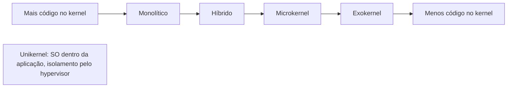
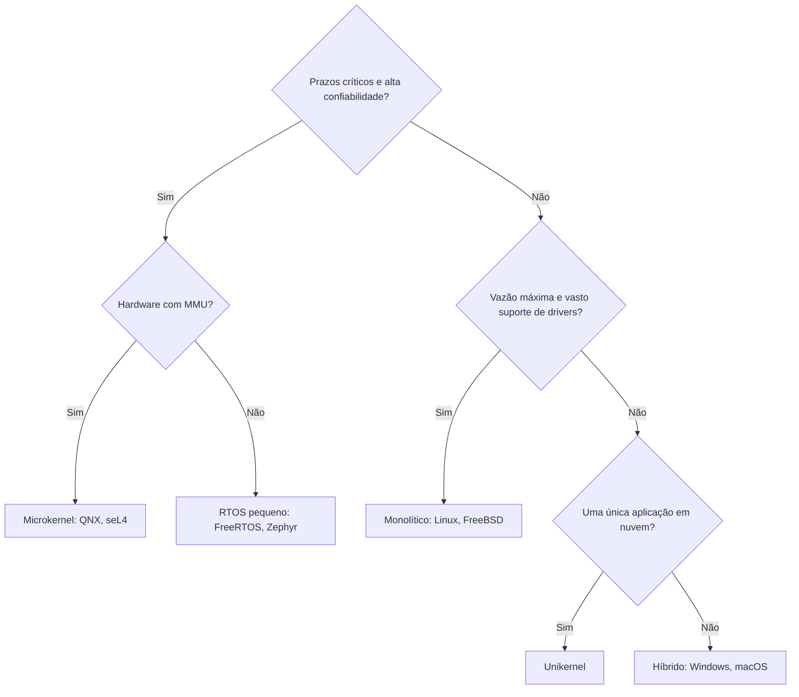

# Comparação de Arquiteturas com Exemplos Reais

## Resumo

Cada arquitetura move a fronteira entre **o que roda com privilégio total** e **o que roda isolado**. Mais código no kernel tende a dar **desempenho**; menos código no kernel tende a dar **isolamento, segurança e confiabilidade**.

## Espectro



## Tabela comparativa por arquitetura

| Critério | [[Kernel Monolítico]] | [[Microkernel]] | [[Kernel Híbrido]] | [[Exokernel]] | [[Unikernel]] | [[Arquitetura em Camadas]] |
|---|---|---|---|---|---|---|
| Código em modo kernel | Muito | Mínimo | Muito | Mínimo | Tudo no mesmo espaço (sem separação) | Depende |
| Desempenho | Alto | Médio (custo de IPC) | Alto | Muito alto (específico) | Muito alto | Médio (sobrecarga de camadas) |
| Isolamento de falhas | Baixo | Alto | Baixo a médio | Médio | Pelo hypervisor | Médio |
| Facilidade de verificação | Baixa | Alta | Baixa | Média | Média | Média |
| Maturidade | Muito alta | Alta em nicho | Muito alta | Pesquisa | Em evolução | Alta (como princípio) |
| Exemplo típico | Linux, FreeBSD | QNX, Minix, seL4 | Windows NT, XNU | Aegis, Xok | MirageOS, Unikraft | THE, pilhas de rede |

## Mapa de sistemas reais

| Sistema | Arquitetura | Linguagem do kernel | Observações |
|---|---|---|---|
| [[Linux]] | Monolítico modular | C (e Rust, crescente) | Módulos carregáveis; eBPF |
| [[Windows NT]] | Híbrido | C, C++ | Executive, HAL, drivers em ring 0 |
| [[macOS e XNU]] | Híbrido (Mach + BSD + I/O Kit) | C, C++ | DriverKit move drivers para user space |
| [[FreeBSD]] | Monolítico modular | C | Base de Netflix CDN, PlayStation |
| [[Minix]] | Microkernel | C | Didático; reinicia drivers com falha |
| [[QNX]] | Microkernel | C | Tempo real; automotivo |
| [[Android]] | Linux (monolítico) + camadas Android | C, C++, Java/Kotlin | Binder IPC, HAL, ART |
| [[iOS]] | XNU (híbrido) | C, C++, Objective-C, Swift | Sandbox rígida, assinatura de código |

## Árvore de decisão simplificada



## Debate Tanenbaum x Torvalds (1992)

Andrew Tanenbaum afirmou que o Linux, monolítico, estava "obsoleto" frente aos microkernels. Linus Torvalds respondeu que desempenho e praticidade importavam mais. O tempo mostrou:

- Monolíticos dominaram servidores e dispositivos de uso geral pela **eficiência e ecossistema de drivers**.
- Microkernels dominaram **sistemas críticos** (QNX, seL4, firmwares de segurança).
- A tendência é **mista**: mover drivers para user space (FUSE, VFIO, DriverKit, UMDF) e usar eBPF/WebAssembly para estender o kernel com segurança.

> [!info] Contexto
> A escolha de arquitetura é um *trade-off*, não uma hierarquia de qualidade. O melhor SO depende da carga, do hardware e dos requisitos de segurança e de tempo.

## Exemplo prático: descobrindo a arquitetura do seu sistema

```bash
# Linux: kernel monolítico com módulos
uname -sr; lsmod | wc -l
# macOS: Darwin / XNU
sysctl kern.version
# FreeBSD
freebsd-version -k
```

```powershell
# Windows: versão do kernel NT
[System.Environment]::OSVersion
(Get-CimInstance Win32_OperatingSystem).Version
```

## Pontos-chave

- Monolítico/híbrido = desempenho e ecossistema; microkernel = isolamento e verificação.
- Exokernel e unikernel exploram especialização extrema.
- Sistemas reais misturam princípios; o rótulo importa menos que o modelo de isolamento.

## Veja também

[[MOC - Arquitetura de Kernels]] · [[Kernel vs User Space]] · [[MOC - Fundamentos - SO]]
