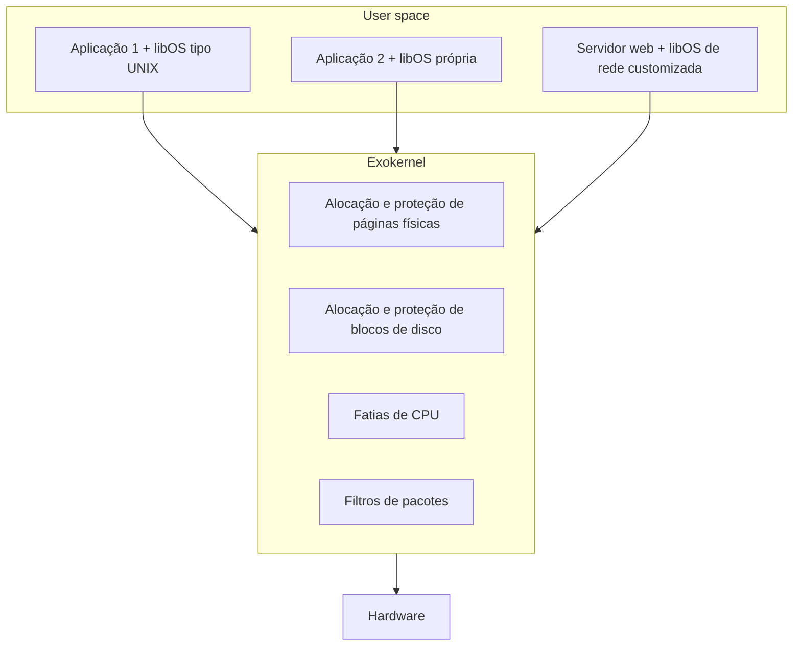

# Exokernel

## Resumo

O **exokernel** (MIT, anos 1990) defende que o kernel **não deve impor abstrações** (arquivo, processo, socket). Ele apenas **multiplexa e protege recursos físicos** (páginas de memória, blocos de disco, fatias de CPU, pacotes) e deixa aplicações escolherem as abstrações por meio de **library operating systems (libOS)** no próprio espaço de usuário.

## Ideia central

> [!info] Princípio fim-a-fim aplicado ao SO
> Abstrações de alto nível custam desempenho quando não casam com a aplicação. Um banco de dados quer controlar o cache de páginas; um servidor web quer controlar o envio de pacotes. Com o exokernel, cada app usa a libOS que mais lhe convém.



## Mecanismos de proteção

- **Secure bindings**: vincula um recurso a uma aplicação no momento da alocação e verifica o acesso depois (rápido), em vez de checar a cada uso por política.
- **Visible revocation**: ao reclamar um recurso, o exokernel avisa a aplicação e deixa que ela escolha qual devolver.
- **Abort protocol**: se a aplicação não coopera, o kernel retira o recurso à força.

## Implementações

| Projeto | Observação |
|---|---|
| Aegis / ExOS (MIT) | Exokernel e libOS de referência |
| Xok (MIT) | Segunda implementação, com libOS compatível com UNIX |
| Nemesis | Exokernel-like para multimídia |

Exokernels nunca viraram produto de massa, mas influenciaram **unikernels**, **kernel bypass** (DPDK, SPDK, RDMA) e a **virtualização** com para-virtualização.

## Exemplo prático

Em Linux, um equivalente moderno de "pular o kernel" é o *kernel bypass* com DPDK (a aplicação fala direto com a placa de rede):

```bash
# Reservar hugepages e ligar a NIC ao driver de user space (VFIO)
echo 1024 | sudo tee /sys/kernel/mm/hugepages/hugepages-2048kB/nr_hugepages
sudo dpdk-devbind.py --bind=vfio-pci 0000:03:00.0
sudo dpdk-testpmd -l 0-1 -n 4 -- -i   # aplicação processa pacotes sem passar pela pilha do kernel
```

## Vantagens e desvantagens

| Vantagens | Desvantagens |
|---|---|
| Desempenho máximo para cargas específicas | Cada aplicação precisa de uma libOS: mais trabalho de desenvolvimento |
| Flexibilidade total nas abstrações | Compartilhamento entre aplicações é mais difícil |
| Kernel muito pequeno | Sem ecossistema nem compatibilidade ampla |
| Elimina camadas redundantes | Proteção exige projeto cuidadoso (secure bindings) |

## Pontos-chave

- Kernel = multiplexador de hardware; abstrações vão para bibliotecas.
- Influenciou unikernels e kernel bypass.
- Mais um modelo de pesquisa do que de produção.

## Veja também

[[Microkernel]] · [[Unikernel]] · [[MOC - Arquitetura de Kernels]]
